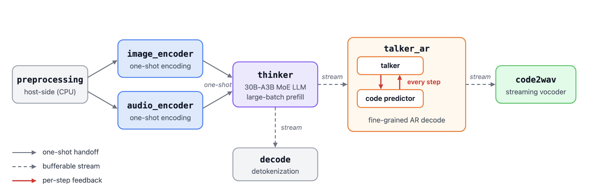
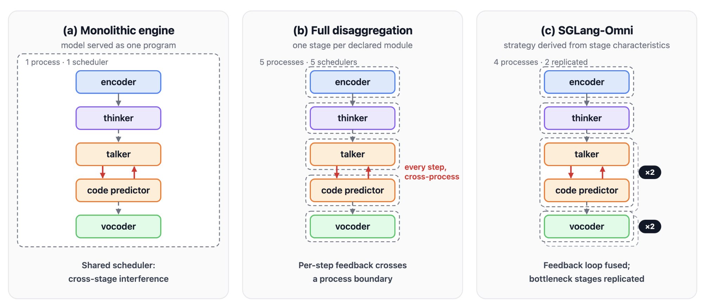
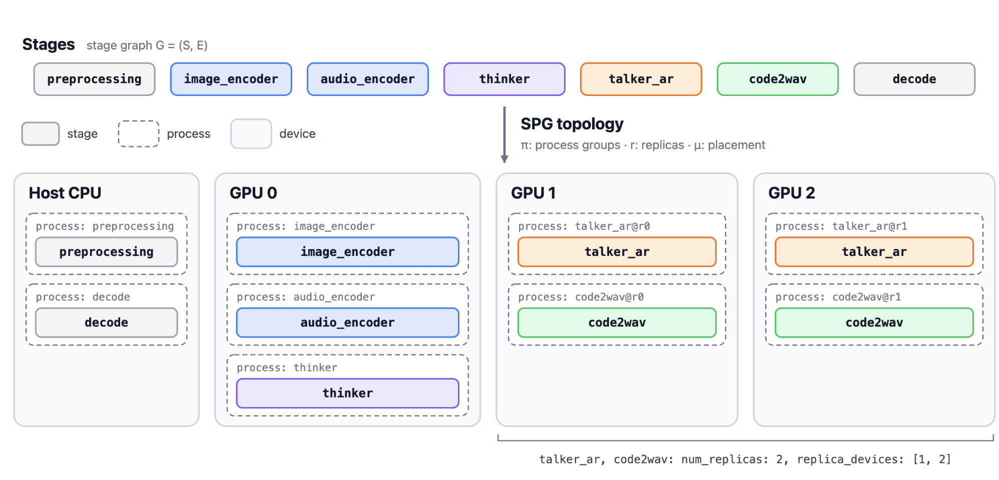
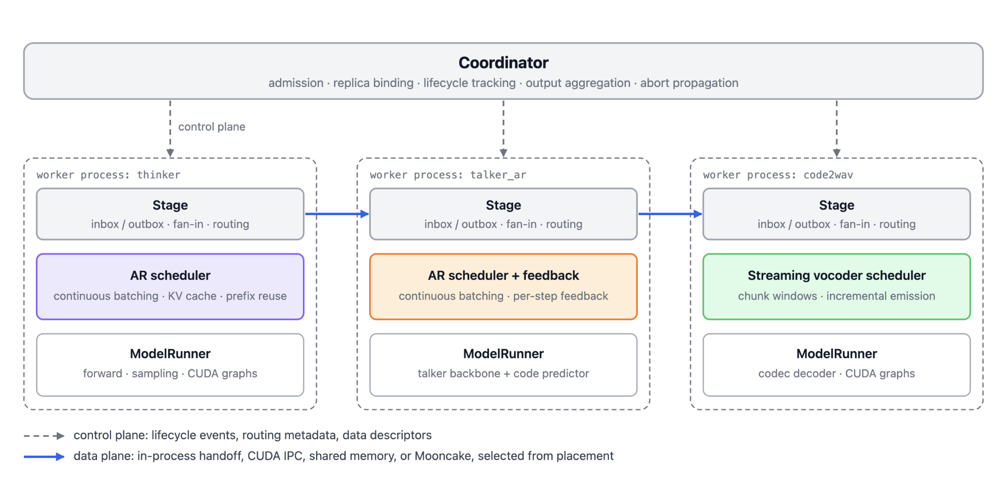

# SGLang Omni: Serving Multi-Stage Omni Models with Heterogeneous Stage Scheduling

**TL;DR**

A request to a modern omni, speech, or TTS model no longer executes as a single autoregressive loop. It traverses heterogeneous stages, such as modality encoders, a thinker, a talker, and a streaming vocoder, and these stages differ in bottleneck resource, resident state, and latency tolerance. We call the way these stages are grouped into processes, replicated, and placed on devices the *execution strategy*. We argue that it affects serving performance as strongly as the efficiency of any individual stage, and that the model architecture should not dictate it. [SGLang-Omni](https://github.com/sgl-project/sglang-omni) represents the execution strategy as a deployment-time configuration, the **Stage–Process–GPU (SPG) topology**, and relates it to three measurable characteristics: the synchronization granularity of each dependency, and the bottleneck resource and resident state size of each stage. Feedback-coupled fusion, process grouping, replication across and within GPUs, encoder–prefill–decode disaggregation, and stage offload are all instances of this single representation. The same runtime realizes each of them without model-specific changes.

### Introduction

Multi-stage decoding is becoming the dominant execution pattern for generative models beyond text. Instead of running a single autoregressive loop, a request traverses multiple *modules*. A module is a computational unit declared by the model architecture, and each holds its own runtime state, such as a KV cache, a feedback buffer, or an accumulation window. Omni models decompose speech generation into an autoregressive thinker, a talker that receives per-step feedback from an auxiliary head, and a streaming vocoder. TTS models interleave a slow semantic decoder with a fast acoustic decoder. Unified multimodal models may route one request through both autoregressive and diffusion modules. Even within one architecture, modules differ in dominant bottleneck, resident state, and latency tolerance.

LLM serving engines, SGLang included, are built around a single decoding loop, which they optimize through continuous batching, paged KV caches, and prefix reuse. Multi-stage decoding breaks this assumption. A serving system must now group modules, or individual phases of modules, into *stages*, the units of scheduled computation. It must also decide each stage's scheduling policy, placement, parallelism, and memory budget. We refer to these decisions collectively as the **execution strategy**. The model architecture declares its modules once, whereas the execution strategy is a deployment-time decision with no counterpart in single-loop serving.

This post describes how SGLang-Omni represents and realizes execution strategies:

- **Computational characteristics.** We identify three measurable properties of stages and their dependencies that predict a suitable execution strategy.
- **SPG topology.** We introduce a deployment representation that specifies process grouping, replication, tensor parallelism, and placement independently of the model's computation.
- **Runtime.** We describe a runtime that realizes any SPG topology. It combines per-stage schedulers behind a uniform interface, feedback-coupled execution, placement-aware communication, and validated per-stage memory budgets.

### Background: Multi-Stage Generative Models

We use Qwen3-Omni as a running example (Figure 1). A speech request passes through the following stages:

- host-side preprocessing;
- image and audio encoders;
- a 30B-A3B MoE thinker that generates the text response;
- a talker that converts the response into speech codec tokens;
- a streaming vocoder (`code2wav`) that synthesizes the waveform.

A separate `decode` stage detokenizes the text output.

<p align="center">
  
</p>

A module executes in one or more *phases*. Each phase advances in a fixed unit: per text token, per codec frame, per waveform window, or in a single shot. Dependencies between modules fall into three synchronization granularities:

- **One-shot handoff.** The producer emits a complete payload once. For example, the thinker consumes encoder embeddings.
- **Bufferable stream.** The producer emits an ordered sequence of chunks, which the consumer may buffer. For example, the talker streams codec frames to the vocoder.
- **Per-step feedback.** The producer cannot begin its next step until the consumer completes the current one. In Qwen3-Omni, each talker step produces the first codebook of a frame, and the code predictor generates the remaining codebooks. The resulting embedding is then fed back into the next talker step.

### Motivation: Architecture-Transcribed Execution

Existing serving systems derive the execution strategy directly from the model architecture: the declared modules, with all of their phases, become the deployed stages. These systems differ mainly in the granularity of this transcription (Figure 2).

<p align="center">
  
</p>

**Monolithic engines** serve the entire model as a single program under one scheduler. Modules with different bottlenecks then contend for the same batching decisions. In Qwen3-Omni, large-batch thinker prefill delays the first frames of the latency-critical talker, and the talker's lightweight steps fragment the thinker's batches.

**Fully disaggregated stage graphs** make every module an independent stage with its own engine and scheduler. This removes interference between modules. However, module boundaries become service boundaries in deployment, and every model receives the same strategy. Dependencies that carry per-step feedback or real-time streams cross scheduler boundaries, so they pay synchronization, serialization, and transfer costs on every step. Regrouping tightly coupled modules requires changing the serving system rather than its configuration.

**Declarative orchestration frameworks** allow modules to be grouped arbitrarily. However, the grouping decision rests entirely with the user, and the system offers no guidance.

In practice, the best-performing strategy often departs from the architecture in both directions:

- **Fusion.** The strategy may merge modules that the architecture separates. Qwen3-Omni's talker and code predictor are distinct modules, but executing their per-step recurrence as a single forward path removes a cross-stage round trip from every generated frame.
- **Replication.** The strategy may run several instances of a module that the architecture declares once. A tuned single instance of a 3B TTS pipeline leaves its GPU largely idle, with SM activity below 30%. Running three complete instances of the pipeline on the same GPU roughly doubles per-GPU throughput.

Both strategies preserve the model's dataflow and outputs, yet neither can be obtained by transcribing the architecture.

### Computational Characteristics

Three measurable characteristics largely determine which execution strategy is suitable:

| Characteristic | Defined on | Obtained from | Decision it informs |
|---|---|---|---|
| Synchronization granularity | Inter-module dependency | The decoding algorithm | Whether a stage boundary may be placed on the dependency |
| Bottleneck resource | Module | Utilization counters and a GPU frequency-scaling check | The scheduling policy, and whether additional instances recover idle capacity |
| Resident state size | Module | The model definition: weights, per-token KV bytes, activation peaks, and stream buffers | The memory budget, and the number of stages or instances per device |

**Synchronization granularity** predicts the cost of a stage boundary. One-shot handoffs and bufferable streams cross a boundary infrequently, so separating their endpoints costs little. Per-step feedback requires one cross-stage synchronization for every generated step, so modules coupled in this way are best grouped into a single stage.

**Bottleneck resource** distinguishes stages that saturate the device from stages limited by host-side work. Consider the Qwen3-TTS 1.7B talker. As concurrency increases from 1 to 16, its median decode-step wall time rises from 15.2 ms to 26.9 ms, while its GPU-busy time rises only from 6.4 ms to 7.2 ms. At concurrency 16, each step launches 155 kernels, and the GPU is busy for only about 27% of the step's wall time. This stage is limited by kernel submission, synchronization, and output handling rather than by arithmetic.

**Resident state size** sets the memory budget of a stage and determines how many stages or instances fit on one device.

These characteristics also combine. A module bottlenecked on host-side dispatch leaves its device largely idle. If its resident state is also small enough to fit several times on that device, the stage can run multiple instances on the same GPU to recover the idle capacity. By contrast, a module that already saturates its device gains nothing from additional instances.

The execution strategy also determines how much lower-level optimizations pay off. Consider CUDA graphs for the Qwen3-TTS vocoder at concurrency 16. In two runs where the vocoder shares a process with the talker, CUDA graphs improve throughput by 7.0% and 9.7%, and reduce mean inter-chunk latency by 10.0% and 9.4%. When the vocoder runs in a separate process, the same optimization is approximately neutral. This is consistent with the vocoder's kernel-launch work moving off the talker's critical path once the two run in separate processes. Kernel-level optimizations therefore cannot be evaluated independently of the topology in which they execute.

### The SPG Topology

SGLang-Omni separates the computation of a multi-stage model from its deployment. A stage graph specifies the local computations and the dependencies between them. An SPG topology specifies how stages are grouped, replicated, parallelized, and placed.

**Stages and the Stage Graph**

A stage is a logical execution unit with a computation, local state, and a scheduling policy. Each scheduled execution of a stage consumes a set of inputs, reads and updates the stage's state, and emits a sequence of output events. The state holds whatever the computation needs across executions, such as request-specific KV caches, feedback, or stream buffers. This interface accommodates one-shot encoders, autoregressive decoding, and incremental waveform synthesis. A stage may contain a whole module, one phase of a module (such as prefill or decode), or several tightly coupled modules.

The stages and their dependencies form a directed acyclic stage graph $\mathcal{G} = (S, E)$, where $S$ is the set of stages and $E$ the set of edges between them. Any recurrence is encapsulated within a stage. Each edge specifies a data schema and a delivery contract. An edge carries either a complete payload or an ordered stream of chunks. Its contract specifies when the consumer may proceed and when the data may be released. The graph also declares an entry stage, terminal outputs, and rules for routing and joins:

- a producer may project its output onto several successors;
- a consumer may wait for several predecessors and merge their payloads;
- a stream consumer may begin executing before its producer finishes.

**Deployment Representation**

For a stage graph $\mathcal{G}$, an SPG topology is

$$\mathcal{T} = (\mathcal{G}, \pi, r, q, \mu).$$

Here, $\pi$ partitions the stages into logical process groups. Each group $\ell$ has $r_\ell$ replicas, and each replica has $q_\ell$ cooperating ranks. The physical processes are therefore all combinations of a group, one of its replicas, and one of that replica's ranks. Finally, $\mu$ places each physical process on a host and either a GPU or the CPU. Each of $\pi$, $r$, $q$, and $\mu$ corresponds directly to a configuration field:

| Component | Meaning | Configuration field |
|---|---|---|
| $\pi$ | Assignment of stages to logical process groups | `stages.<stage>.process` |
| $r_\ell$ | Number of replicas of group $\ell$ | `processes.<group>.num_replicas` |
| $q_\ell$ | Tensor-parallel ranks per replica | `stages.<stage>.tp_size` |
| $\mu$ | Host and device of each process | `stages.<stage>.gpu`, `processes.<group>.replica_devices` |

Process grouping, replication, tensor parallelism, and GPU sharing are therefore specified separately:

- A single-rank group may contain several stages that share one OS process.
- A tensor-parallel stage occupies its own group and materializes one process per rank.
- Replication copies an entire group, so all member stages have the same replica count and are copied together.
- Placement may assign different replicas or different groups to the same GPU.

Before starting any worker, the runtime does the following:

1. resolves stage declarations and process membership;
2. expands replicas;
3. validates placement and declared memory budgets;
4. constructs communication endpoints.

Routing declarations refer to stages by their logical names, so expanding replicas requires no model-specific routing code. The following configuration replicates the speech-generation stages of Qwen3-Omni across two GPUs, and Figure 3 shows the resulting topology.

```yaml
config_cls: Qwen3OmniSpeechPipelineConfig
model_path: Qwen/Qwen3-Omni-30B-A3B-Instruct

stages:
  talker_ar:
    gpu_memory_fraction: 0.123
  code2wav:
    gpu_memory_fraction: 0.014

processes:
  talker_ar:
    num_replicas: 2
    replica_devices: [1, 2]
  code2wav:
    num_replicas: 2
    replica_devices: [1, 2]
```

<p align="center">
  
</p>


**Representative Topologies**

Common execution strategies are all instances of the same representation. They differ only in how stages are grouped, replicated, parallelized, and placed:

| Topology | Configuration | Motivating characteristic |
|---|---|---|
| Feedback-coupled fusion | Coupled modules form a single stage | Per-step feedback |
| Process grouping | Several stages share one process group | Low-cost in-process handoff |
| Cross-GPU replication | A group has several single-rank replicas on different GPUs | Device-bound bottleneck |
| Same-GPU replication | A group has several replicas on the same GPU | Host-bound stage with small resident state |
| EPD disaggregation with TP | Encoder, prefill, and decode in separate groups; tensor parallelism within prefill and decode | Phase-specific scheduling and parallelism |
| EPD with replication | Each phase group has its own replica count and placement | Phase-specific capacity |
| Stage offload | Fixed topology; sequential stages take turns keeping their weights on the GPU | Device memory capacity |

**Feedback-coupled fusion.** For modules coupled by per-step feedback, SGLang-Omni expresses the recurrence inside a single stage. The stage's state holds the feedback carried to the next step alongside its autoregressive state. Model hooks manage the feedback in three places:

1. They initialize it during prefill.
2. They inject it before the next forward pass.
3. They update it after the backbone and the auxiliary head execute.

In Qwen3-Omni, the talker and code predictor therefore run as a single `talker_ar` stage, and no inter-stage handoff occurs within the recurrence.

**Process grouping.** For single-rank stages, assigning two stages to the same process group places their instances in one process while preserving each stage's computation and scheduler. Assigning them to different groups instead allows each stage to have its own replica count. Neither choice changes the stage graph, provided the edge contracts support the chosen boundary. Some edges exchange state through process-local structures. The model declares these edges, and any topology that would split one is rejected at compilation time. Process membership is a per-stage field that can be overridden at launch. For example, the Qwen3-TTS vocoder shares the pipeline process by default and can be isolated with:

```bash
sgl-omni serve --model-path Qwen/Qwen3-TTS-12Hz-1.7B-Base --vocoder.process vocoder
```

Placement also informs grouping. When Qwen3-Omni is colocated on a single GPU, separate processes would time-slice the device. The colocated configuration therefore runs `code2wav` inside the talker's process, on a priority CUDA stream.

**Stage replication.** For each admitted request, the coordinator selects one replica of every group that the request touches. This binding is fixed for the lifetime of the request and governs payload, stream, completion, and abort handling. As a result, stages in the same group use the same replica. Several replicas may be placed on the same device, so assigning every replica of a group to one GPU yields same-GPU replication:

```yaml
processes:
  pipeline:
    num_replicas: 2
    replica_devices: [0, 0]
```

```bash
sgl-omni serve --config <config.yaml> --mps on --weight-share on
```

CUDA MPS lets the replicas' CUDA contexts execute concurrently. Compatible replicas can also share immutable weights through CUDA IPC: a leader replica owns the weight allocation for as long as its followers run. KV caches, sampler state, CUDA graphs, and request buffers remain private to each replica. Every GPU stage on a shared device declares a `gpu_memory_fraction`, and the runtime validates the per-device total before spawning any process.

**EPD disaggregation.** Encoding, prefill, and decode can run in separate process groups. The encoder uses a single rank, while prefill and decode use the same tensor-parallel degree. The encoder output is forwarded once to prefill. When the KV layouts are compatible and both phases run on the same host, each prefill rank transfers its KV shard to the corresponding decode rank over CUDA IPC. TP collectives remain internal to each replica.

The same graph supports independent replica counts and GPU sharing. For example, with single-rank groups on three GPUs, three encoder replicas, one prefill replica, and three decode replicas can be placed as follows:

- three encoder replicas share GPU 0;
- prefill and one decode replica share GPU 1;
- the other two decode replicas share GPU 2.

**Stage offload.** Consider two sequential single-replica stages on one GPU, of which only one keeps its weights on the GPU at a time. When execution switches from the first stage to the second, the first stage's weights are unloaded to host memory after it completes, and the second stage's weights are loaded before it runs. Only weight residency changes; the topology and the request binding stay fixed. KV caches remain on the GPU and continue to count toward the memory budget.

### Runtime Design

The runtime realizes an SPG topology through four layers, Coordinator → Stage → Scheduler → ModelRunner (Figure 4).

<p align="center">
  
</p>

- The **Coordinator** establishes the replica binding $\beta_a$ and tracks request lifecycles. It also aggregates terminal outputs, resolves client responses or streams, and propagates aborts.
- A **Stage** handles readiness, input assembly, and communication along $E$. Every stage exposes the same scheduler inbox/outbox interface, which carries requests, stream chunks, completion signals, results, and errors.
- A **Scheduler** manages its own queues and batches.
- A **ModelRunner** implements $F_s$, including forward execution, sampling, hooks, and output conversion.

Because of this separation, process grouping can change without merging the scheduling policies of the member stages. For a fixed execution contract, changing $(\pi, r, \mu)$ reuses the same ModelRunner implementation of $F_s$. For example, EPD adds stage handoffs and prefill/decode scheduling, but decode still invokes the existing CUDA-graph-enabled ModelRunner. Adding decode replicas instantiates that same runner in more workers. Topology changes therefore inherit model-specific execution optimizations, with no separate implementation for each deployment.

**Heterogeneous Scheduling**

Each stage type uses a scheduling policy suited to its workload:

- **Autoregressive stages** reuse SGLang's continuous batching, KV-cache management, and prefix reuse. They can also overlap host-side result processing with the next decode step through one-step-lookahead asynchronous decoding. Stage inputs are translated into scheduler requests, while inter-stage streaming and request bookkeeping stay outside the model runner.
- **Encoders, preprocessing, and other non-autoregressive stages** execute directly, with optional local batching.
- **Streaming vocoders** maintain per-request synthesis state and accumulate codec chunks into executable windows. They emit waveform segments incrementally and flush any remaining data when the stream completes.

These policies determine when $F_s$ is invoked and how $I_s$ is formed, while $x_s$ retains the stage's per-request state.

**Placement-Aware Communication**

Inter-stage communication is split across two planes. The control plane carries request lifecycle events, routing metadata, and data descriptors. The data plane moves tensor buffers through a backend-neutral relay interface. In a relay-backed handoff, the producer publishes the data together with a descriptor, and the consumer uses the descriptor to fetch the data before admitting dependent work. For an edge $u \to v$ with endpoint processes $p$ and $p'$, the transport is chosen from the locality of the endpoints and the compatibility of the data:

| Endpoint relationship | Data movement |
|---|---|
| $p = p'$ | Direct object handoff |
| $p \neq p'$, $\mu(p) = \mu(p')$, $d_p \neq \bot$ | Direct CUDA IPC for eligible GPU tensors |
| $h_p = h_{p'}$ | Pooled CUDA IPC for supported GPU transfers; shared memory for CPU tensors or as a fallback |
| $h_p \neq h_{p'}$ | Mooncake relay over configured remote endpoints |

Every path preserves readiness, stream ordering, and data lifetime. Backend-specific ownership and completion tracking govern when buffers are reclaimed. As a result, changing $\mu$ changes the transport but preserves $E$ and $\beta_a$.

**Preserving Request Semantics**

Correctness follows from three invariants:

1. Local execution implements $F_s$.
2. Request state stays with the replica selected by $\beta_a$.
3. Communication preserves the contracts in $E$.

Consider a completed request with fixed transition semantics, including sampling choices. By induction over its causally ordered execution events, every consumer receives the predecessor data it requires and advances the corresponding state. Terminal stages therefore produce the same per-output data sequences as the logical graph. This argument holds under changes in batching, placement, and delivery time, provided that stage implementations satisfy the invariants above.


## Evaluation and Performance

We compared SGLang-Omni with three other open-source omni and speech serving engines, labeled OSS 1, OSS 2 and OSS 3, on 18 models: 10 text-to-speech models, 6 speech recognition models and 2 omni models. Each engine served each model it supports with its own server and out-of-the-box settings, on the same H200, driven by the same HTTP client. In every chart, SGLang-Omni is the leftmost bar; the other engines' order and colors are shuffled per model, and a red cross marks a model the engine does not support.


1. Text To Speech Model Throughput

<p align="center">
  
</p>


2. Text To Speech Model Time To First Audio

<p align="center">
  
</p>


3. Text To Speech Model Quality

<p align="center">
  
</p>

4. Speech Recognition Model Throughput

<p align="center">
  
</p>


5. Speech Recognition Model Quality

<p align="center">
  
</p>

6. Omni Model On Speech Workload Throughput

<p align="center">
  
</p>

7. Omni Model On Speech Workload Time To First Audio

<p align="center">
  
</p>


SGLang-Omni has the highest throughput on every model in the comparison:

| Family | Models | Throughput vs the fastest other engine |
|---|---:|---|
| Text-to-speech, concurrency 16 | 10 | 1.10× to 3.68× (Higgs Audio v3 3.26×, MOSS-TTS v1.5 3.68×, Fish Audio S2-Pro 2.74×, Qwen3-TTS 1.40× to 1.61×) |
| Speech recognition, concurrency 32 | 6 | 1.16× to 1.81× |
| Omni with speech output, concurrency 16 | 2 | Qwen3-Omni 1.32×, MiniCPM-o 4.5 6.41× |

Streaming time to first audio at concurrency 16 (p95) is the lowest on 9 of the 10 text-to-speech models and ties on MOSS-TTS Local (0.45 s for both). It is also lower on Qwen3-Omni (0.41 s vs 0.50 s). Output quality matches: SeedTTS WER is within 0.15 points of the best other engine on every model but one. The exception is MOSS-TTS Local (1.79% vs 1.43%), where our output matches the official reference implementation and the other engine's speaker similarity is about 10 points lower.

All of these numbers come from a single instance per GPU. The same-GPU replication topology described below raises them further: three replicas of the Qwen3-TTS 1.7B pipeline on one H200 deliver 1.60× the streaming throughput of one instance at concurrency 96, and three CosyVoice3 replicas at concurrency 48 deliver 2.05× the non-streaming throughput of one instance at concurrency 16.

### Methodology and Reproduction

| Setting | Value |
|---|---|
| Hardware | One NVIDIA H200 (141 GB) per model; every engine ran on the same GPU and the same pinned CPU cores, back to back |
| Serving | Each engine's own server with its default configuration, one instance, CUDA MPS off, Hugging Face Hub offline after the weights were downloaded |
| Versions | SGLang-Omni `main` as of 14 October 2026, which includes PRs #2798, #2799, #2801, #2804 and #2805, plus PR #2800; other engines at their latest release or `main` as of 13 October 2026 |
| Text-to-speech | SeedTTS EN, all 1,088 prompts; voice cloning from each item's reference audio (CustomVoice checkpoints use a fixed speaker); throughput non-streaming and TTFA streaming, both at concurrency 16; 32 warm-up requests excluded |
| Speech recognition | 1,088 SeedTTS EN reference clips through `/v1/audio/transcriptions`, temperature 0, concurrency 32; 64 warm-up requests excluded |
| Omni | Qwen3-Omni: a fixed 256-prompt SeedTTS EN subset, read-aloud instruction, thinker capped at 256 tokens, streamed audio. MiniCPM-o 4.5: SeedTTS EN 1,088 voice cloning, offline |
| Statistics | Mean of three passes; quality scored on the first pass with whisper-large-v3; outputs above 50% WER are counted as runaways and excluded |

The comparison used one engine-neutral HTTP client for all engines. For text-to-speech and omni, the benchmark scripts in the SGLang-Omni repository reproduce the SGLang-Omni numbers within about 6%:

```bash
git clone https://github.com/sgl-project/sglang-omni.git && cd sglang-omni
uv pip install --prerelease=allow -v -e .
python -m benchmarks.dataset.prepare --dataset seedtts

# Text-to-speech, for example Qwen3-TTS 1.7B Base
sgl-omni serve --model-path Qwen/Qwen3-TTS-12Hz-1.7B-Base --port 8000
python -m benchmarks.eval.benchmark_tts_seedtts \
    --meta zhaochenyang20/seed-tts-eval-arrow \
    --model Qwen/Qwen3-TTS-12Hz-1.7B-Base --port 8000 \
    --lang en --max-concurrency 16

# Speech recognition, for example Qwen3-ASR 1.7B
sgl-omni serve --model-path Qwen/Qwen3-ASR-1.7B --port 8000
python -m benchmarks.eval.benchmark_asr_seedtts \
    --port 8000 --concurrencies 32 --repeats 3 --warmup

# Omni, Qwen3-Omni
sgl-omni serve --model-path Qwen/Qwen3-Omni-30B-A3B-Instruct --port 8000
python -m benchmarks.eval.benchmark_omni_seedtts \
    --meta zhaochenyang20/seed-tts-eval-arrow \
    --model qwen3-omni --port 8000 \
    --max-concurrency 16 --max-samples 256
```

The usage notes at the top of each script cover the other models, including reference formats for Higgs Audio and MOSS-TTS and speaker presets for Voxtral. Set `HF_HUB_OFFLINE=1` once the weights are cached, so that no engine contacts the Hugging Face Hub while serving.

## Acknowledgments

It takes us for over half a year to retake SGLang Omni back to life. Thanks to all the people who helped us along the way.

SGLang Omni team: Chenyang Zhao, Jingwen Gu, Shenggui Li, Richard Wang, Yichi Zhang, Xuesong Ye, Jiaxin Deng, Ratish P, Jiaxuan Luo, Xinyu Lu, Wenyao Gao, Ao Sun, Jintao Qu, Kaige Li, Yuhao Chen, Yuhan Zhou, Xuxiang Tian, Ruoyi Zhang, Junnan Li, Yixiao Zeng, Chenchen Hong, Shenggui Li

Moss AI Team: Yang Gao, Chaoye Fei, Yitian Gong, Chen Yang, Yiyang Zhang, Xipeng Qiu

Boson AI Team: Huapeng Zhou, Silin Men, Ke Bai, Dongming Shen, Mu Li, Alex Smola

FishAudio Team: Shidong Li, Xuehao Yang, Shijia Liao