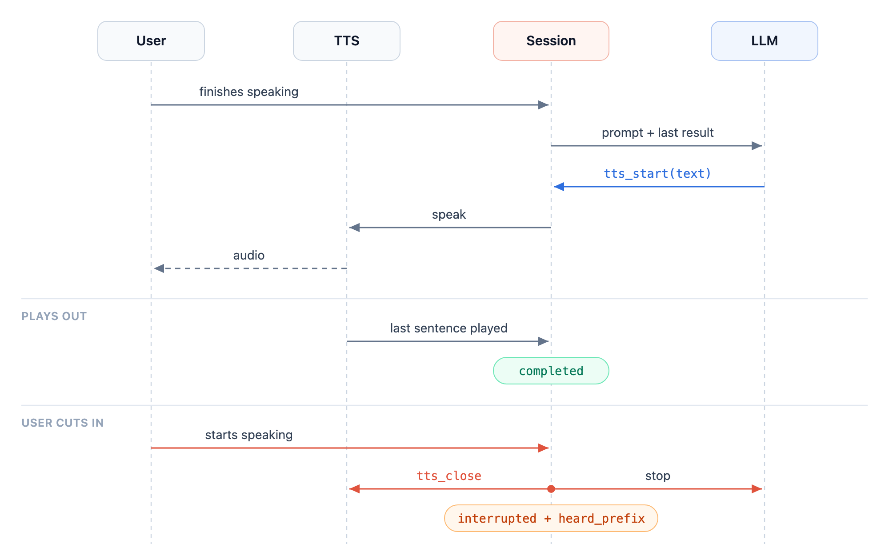
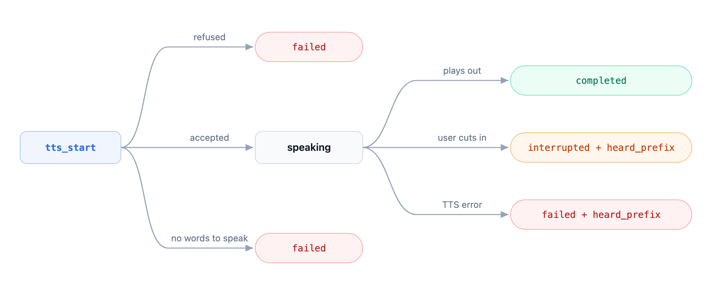

# 说话是一种行动：将 TTS 变成 interactive model 的 tool

## TL;DR

模型越来越聪明，人与模型之间却仍是一问一答，而人和人的交流是 interactive 的。SGLang Omni 用开源模型构建 interactive 系统，第一步是 ASR、LLM、TTS 的级联。旧的级联会把 LLM 写出的每个 token 都念出来，于是陷入两难：关掉 thinking，模型很笨；打开 thinking，它又啰嗦到没法念。我们本来就想让级联调用工具，想清楚之后发现，最好的形式是让 TTS 本身成为第一个工具：对 LLM 来说，说话和 Google 搜索、查天气没有任何区别，都是一次工具调用。模型决定说什么，系统决定何时停，并通过 `heard_prefix` 告诉模型用户听到了多少。相较于之前念出每个 token 的设计，新的设计流式输出工具参数，并用预填充的调用开头跳过 thinking，把三个模型在三句话请求上的首音频中位延迟从平均 1,826 ms 降到了 567 ms。

[](https://youtu.be/BAXd3yOU7Ag)

## 为什么要做 interactive model

模型的智力在快速增长，人与模型协作的方式却几乎没有变：写一段 prompt，等一段回复。人和人的交流不是这样。双方共享同一段时间和情境，一边感知一边回应：对方话音未落就开始回应，看到对方皱眉就换个说法，情况一变就立刻改变方向。话轮之间的间隙只有 200 毫秒左右，比准备一句话所需的 600 毫秒还短（Levinson & Torreira, 2015），约 40% 的说话人交替是重叠的（Heldner & Edlund, 2010）。轮次式系统把这一切压扁成对讲机式的轮流，让人去适应机器：一口气说完，不能停顿，不能插话，只能等。它只能靠静音去猜你何时说完，所以要么在你停下来思考时抢话，要么让每一轮都多等一段。

更深的问题在于模型本身。语言模型以单线程的方式经历世界：用户说话时，它只能等；它生成时，世界对它是静止的。它看到的是一段 prompt，不是一条流，察觉不到你犹豫了、移开了视线，察觉不到自己答偏了，也感觉不到 10 秒已经过去。有一种观点认为，人是一台每 200 毫秒接收一次输入的 thinking machine。Thinking Machines Lab 的 interaction model 以 200 毫秒为单位持续读入音频、视频和文字，同时产出回应，才有可能学会什么时候该回应、什么时候该等、什么时候该停。

交互也不是一层可以事后套上的外壳。每一刻都有一个决定要做：开口、等待、停下，还是先去查点什么。这些决定和回答本身一样需要智力；交给静音阈值和手写规则，它们就会比模型本身笨，并随着模型进步而愈发落后。所以，目标不是一个更快的轮次式系统。全双工，也就是同时感知和回应，只是手段；真正的目标是一个会交互的模型，它的交互能力随智力一起增长，贯穿它能感知和产出的每一种模态。

## 我们的级联

原生全双工模型，如 Thinking Machines Lab 的 interaction model、OpenAI 的 GPT-Live 和 Moshi（Défossez et al., 2024），端到端地学习交互，但它们需要强大的全模态基座模型，而这样的开源模型很少。轮次式的全模态模型依然一轮一轮地回应。级联把 VAD、ASR、LLM 和 TTS 串起来，用的正是开源社区最不缺的部件：每一块都能随着更好的开源模型单独升级，出了问题也能定位到具体是哪一块。代价是信息损失：ASR 会丢掉语气，也会把多人的话混成一个人。SGLang Omni 的[流式级联](https://www.sglang.io/blog/omni-interactive-runtime)由一个 Session 统一调度这些部件：它持续运行交互管理，判断用户何时结束输入、何时插话，负责停止播放，并让对话历史与实际播出的内容保持一致。级联是通往 interactive model 的过渡。在开源模型能独立做出所有交互决定之前，我们的原则是：模型能做好的决定交给模型，模型还感知不到的信号由系统协调，并随着模型变强逐步交还给模型。

## 为什么 TTS 应该是一个工具

想象一下，你正在驾驶电动汽车，询问车内的智能助手今天天气如何。你期望听到什么，又期望看到什么？你想听到的只是一句"今天 22 度"，想看到的却可以是中控屏上一整周的天气。在这句话背后，模型已经先查过了天气。人想听到的东西要简洁，想看到的东西可以丰富。这样的交互体现出高度的智能：模型清楚地知道该思考什么，该展示什么，又该念出什么。

我们之前的级联不是这样工作的。ASR、LLM、TTS 是同一层级的节点，LLM 写出的每个 token 都会被 TTS 念出来。表面上的问题是有些 token TTS 根本念不对：表情符号、Markdown 的星号、表格。这些可以过滤掉。本质问题在于，开源 LLM 大多是为 coding 训练的，说起话来也像写代码：又长又有结构，一开口就是成千上万个 token。关掉 thinking，模型就变笨，说的内容要么不对，要么调不好工具；打开 thinking，模型变聪明了，可没有人想听完它写的每一个字。

把每个 token 都念出来，还会让模型不知道用户到底听到了什么。用户插话时，旧的级联会把历史里的回复截断到已播放的部分，以"…"结尾，再加一条系统说明。模型会在上下文里学到这种错误的输出方式：即便这一轮没有被打断，它也给不出完整的回答，而是以省略号结尾。沿用 [#3255](https://github.com/sgl-project/sglang-omni/pull/3255) 的设置，给模型一段 20 轮、每条回复都被打断的历史：按旧级联的方式关掉 thinking 时，Qwen3.8-27B 有 12.5% 的最终回答以省略号结尾（128 个中的 16 个）；开着 thinking 时，三个模型都没有出现（见[评估](#评估)）。

所以 TTS 不能什么都念，得由模型来挑。与此同时，我们本来就想让级联系统能调用工具：车里那个智能助手，得先查到天气才能回答。仔细想过之后，我们认为 TTS as a Tool 是同时解决这两件事的最好形式，于是 TTS 成了我们的第一个工具。我们把 TTS 从流水线中的一个节点降级为一个工具；对 LLM 来说，`tts_start` 和 Google 搜索、查天气没有任何区别。模型决定说什么；系统决定语音何时必须停止，并记录用户大概听到了什么。两者之间的接口是一次工具调用。这也是我们在"说话"这件事上，对运行时那篇文章留下的问题给出的回答：交互行为有多少该由模型学会，有多少该由系统来协调。

## 系统设计

Session、LLM 和 TTS 之间的协作遵循三条规则：

- **只有 Session 会改变状态。** LLM 发出动作，TTS 执行动作，只有 Session 决定语音是否在播。节点之间从不直接通信，所以它们对状态的认知不会漂移。
- **每个动作只有一个所有者。** `tts_start` 属于 LLM，`tts_close` 属于 Session，不会有人为"谁停了什么"产生竞争。
- **每次调用只有一个应答。** 一次 `tts_start` 对应一个工具响应，所以只需要 `tool_call_id` 这一个 ID。

| 动作 | 调用方 | 作用 |
|---|---|---|
| `tts_start(text)` | LLM | 把文本切分成句子，然后逐句合成并播放 |
| `tts_close` | Session，在用户开始说话时 | 立即停止播放并清空缓冲区。它不在 LLM 的工具列表中。 |

一个 Session 同一时间只播放一段语音。播放中再收到 `tts_start`，会得到 `BUSY`，而不是替换掉当前语音。

<div align="center">
  
</div>

每次 `tts_start` 都恰好以一种结果结束：

<div align="center">
  
</div>

`heard_prefix` 是文本中根据播放记录判断用户已经听到的部分（[计算方式](#计算-heard_prefix)）。

**打断走快速路径。** 语音活动检测（VAD）一检测到用户说话，Session 就立即关闭 TTS 并停止 LLM，不去询问 LLM。如果先让用户的话经过 ASR 和 LLM，就会多播出一段音频，这段音频会被记为"已听到"，可用户当时正在说话，其实没听到。

## 设计权衡

### 开不开 thinking？

整个设计正是从这个权衡出发的。不开 thinking，模型对这类工具的 zero-shot 泛化很差（很遗憾，我们发现，模型在不开 thinking 的时候，几乎没有 zero-shot 操作工具的能力）：三个模型里只有 Qwen3.8-27B 能关掉 thinking，关掉之后，把 `tts_start` 作为可选项时，80 个首轮 prompt 中只有 1 个调用了它；在系统 prompt 里加一句"用户只能听到工具说出的内容"，也只有 15 个。开了 thinking，这一句话就够了：在 low 和 medium 两个档位下，三个模型在 80 个 prompt 中有 74 到 80 个调用了工具。如果只靠工具描述自己去推断，只有 Inkling 2 Small 会调用（80 个中的 72 和 73 个），Inkling 2 Mini 和 Qwen3.8-27B 大多直接用纯文本回答。因为 TTS 是工具，thinking 的内容永远不会被念出来。代价是延迟：medium 档位下，写完整段文本、出第一段音频之前，中位要等 1.5 s（Inkling 2 Mini）到 3.5 s（Qwen3.8-27B）。因此发布的 profile 强制调用并预填充调用开头，从而跳过 thinking（见[下一节](#让真实模型用起来)）；Qwen3.8-27B 的 profile 还关掉了 thinking，Inkling 无法关闭，使用 `reasoning_effort` 0.1。怎样让 thinking 便宜到可以一直开着，仍是开放问题。

| 指标（thinking low / medium） | Inkling 2 Mini | Inkling 2 Small | Qwen3.8-27B |
|---|---:|---:|---:|
| 可选的 `tts_start` 被调用，使用发布的系统 prompt（/80） | 8 / 8 | 72 / 73 | 1 / 3 |
| 可选的 `tts_start` 被调用，多加一句"用户只能听到工具说出的内容"（/80） | 78 / 80 | 80 / 80 | 80 / 74 |
| medium 档位、一句话请求、SGLang parser 下的首音频中位延迟 | 1.5 s | 2.0 s | 3.5 s |

### 调用何时得到应答？

一段语音会持续几秒，模型需要知道它是怎么结束的。如果立刻用"已接受"应答 `tts_start`，之后再单独上报完成情况，每次调用就有两个应答；要把它们关联起来就得再加一个 ID，之后每个操作都要带着它。

我们只在模型需要据此行动时才应答：被拒绝的调用立即应答，被接受的调用在语音结束时应答一次。一次调用，一个结果，不需要第二个 ID。代价是模型在说话期间什么也不知道，但这几乎没有损失，因为这段时间本来也没有东西会 prompt 它。

### 谁可以停止一段语音？

我们考虑过让 LLM 自己关闭语音、提供能改写正在播放句子的 `tts_edit`、让新的 `tts_start` 替换当前语音，以及把并发的 start 排队。最终选了最窄的方案：只有 VAD 会触发关闭，并且要经过 Session；第二个 start 得到 `BUSY`。

LLM 不知道自己的语音播到了哪里，也没有在这类接口上训练过，没法指望它在正确的时刻停下。edit 需要句子切分、锁定点、版本号，还要能丢弃过时的音频。close 本身就会返回停止位置，"关闭再重来"能以少得多的机制满足同样的需求。代价是模型无法在一段语音中途自我纠正。

### 模型如何得知听到了什么？

Session 把停止位置写进工具结果，并随着播放报告的到达更新它：默认按句子边界估计，开启对齐器时用词级时间戳。下一个 prompt 会带上新的输入和这个结果。被打断的语音进入历史有三种方式：

| 方案 | 模型看到的内容 |
|---|---|
| 把回复截断到已听到的部分（旧级联） | 一条以省略号结尾的助理回复，外加一条系统说明 |
| 在用户消息中加入打断说明 | 已听到的文本，夹在用户对这次打断的描述里 |
| 保留调用，把 `heard_prefix` 放进工具响应（我们的方案） | 生成的文本在调用里，已听到的文本在调用结果里 |

我们的方案把模型写了什么和实际播了什么分开记录，调用里保留模型被打断时已经写出的全部文本。在 Qwen3.8-27B 的一次回放中，调用里写的是 "The parcel code is V2P2."（取件码是 V2P2。），`heard_prefix` 停在 "The pickup desk is next to the main entrance."（取件台在正门旁边。）。被问到是否已经念过取件码时，模型下一次 `tts_start` 说的是 "Not yet read. The code is V2P2."（还没念。取件码是 V2P2。）同一回放中，Inkling 2 Mini 说的是 "Not yet read; the code is V2P2."，Inkling 2 Small 说的是 "Not yet read. Your code is V2P2."（三个模型的 thinking 均为 low）。

## 让真实模型用起来

**强制调用。** 设置 `tool_choice: required` 后，在两个 thinking 档位下，每个模型的 80 个首轮 prompt 全部调用了 `tts_start`。如果服务端忽略了 `tool_choice`，模型写出了纯文本，这段文本会被当作一次 `tts_start` 调用来朗读，结果也按同样方式上报。

**结束一轮。** 如果每个 prompt 都要求调用，模型就无法选择沉默。我们试过给它一个 `silent` 工具。在 Session 的第一次输入上，模型用得不错：480 个普通问题中只有 12 个选择了沉默（全部来自 Qwen3.8-27B），480 个要求不要回复的输入中有 454 个选择了沉默。但一段语音完成之后就不行了：在没有任何新内容需要回答的情况下再次 prompt，三个模型合计 480 个样本中有 130 个又说了一遍话，其中 109 个是把同一个答案再说一遍。所以现在系统在每次用户输入、一次成功的语音之后就结束这一轮，并把结果放进下一个 prompt。只有调用被拒绝或语音失败时才会再次 prompt 模型，每次输入最多四次。

**首音频延迟。** SGLang 自带的工具调用 parser（Qwen3.8-27B 用 `qwen3_coder`，Inkling 2 Mini 和 Inkling 2 Small 用 `inkling2`）要到闭合标签才释放 text 参数，合成器只能等整段参数写完。我们做了两处改动：

1. 我们的 chat service 在模型书写的同时流式输出 `text` 参数，模型还在写后面的内容时，第一句已经在合成了。
2. 我们[预填充调用开头](https://github.com/sgl-project/sglang-omni/pull/4472)，作为一条让模型续写的 assistant 消息（`continue_final_message: true`，`tool_choice: auto`），解码直接从要说出的文本开始。Qwen3.8-27B 的开头是 14 个 token 的 `<tool_call>\n<function=tts_start>\n<parameter=text>\n`；Inkling 2 Mini 和 Inkling 2 Small 的开头是一句话的 thought，加上 Inkling 发起 `tts_start` 调用的那几个 token：`<|message_model|><|content_thinking|>The user asked something; I answer it rather than repeat it.<|end_message|><|message_model|>tts_start<|content_invoke_tool_json|>{"name":"tts_start","args":{"text":"`。这段开头把 thinking 块也写好了，所以这条路径上不再生成 thinking。

| 开 thinking（请求一句 / 三句） | Inkling 2 Mini | Inkling 2 Small | Qwen3.8-27B |
|---|---:|---:|---:|
| Low，TTS 朗读模型的文本（旧流水线） | 890 / 1,263 ms | 1,265 / 1,579 ms | 2,192 / 2,637 ms |
| Low，`tts_start`，SGLang 的 parser | 1,191 / 1,866 ms | 1,828 / 2,403 ms | 3,304 / 3,124 ms |
| Low，`tts_start`，流式参数 | 1,168 / 1,872 ms | 1,870 / 2,252 ms | 3,308 / 2,717 ms |
| Medium，TTS 朗读模型的文本（旧流水线） | 914 / 1,313 ms | 1,464 / 1,718 ms | 4,827 / 5,701 ms |
| Medium，`tts_start`，SGLang 的 parser | 1,455 / 2,033 ms | 2,027 / 2,923 ms | 3,536 / 3,783 ms |
| Medium，`tts_start`，流式参数 | 1,494 / 1,998 ms | 2,021 / 2,648 ms | 3,525 / 3,345 ms |

表中每个模型都开着 thinking，且处于同一个命名档位：low 和 medium 对 Inkling 是 `reasoning_effort` 0.2 和 0.7，对 Qwen3.8-27B 是 `low` 和 `medium`。表中没有预填充开头，因为开头让回复直接从要说的文本开始，没有思考的余地。使用预填充开头时，所有模型都不生成 thinking，首音频延迟为：

| 不生成 thinking（请求一句 / 三句） | Inkling 2 Mini | Inkling 2 Small | Qwen3.8-27B |
|---|---:|---:|---:|
| `tts_start`，流式参数 + 预填充开头 | 544 / 540 ms | 608 / 535 ms | 894 / 625 ms |

每种配置、每种回复长度都回放同样的 15 段音频，每个轮次都产出了音频（每种配置、每种回复长度均为 15/15）。表中为中位数，计时从客户端发出包含 VAD 检测到的语音结束的数据包开始，到收到第一个非空音频块为止。三句话请求、thinking 为 low 时，流式输出参数为 Inkling 2 Small 节省了 148 ms，为 Qwen3.8-27B 节省了 417 ms（medium 时为 140 ms 和 374 ms；15 段音频的成对中位数）。它对 Inkling 2 Mini 没有可测的帮助（16 ms 和 12 ms），因为 Mini 在写出第一个词之后约 70 ms 内就写完了整段回复；一句话请求上它对任何模型都没有帮助，因为这时参数本来就只有一句。开着 thinking 时，流式工具路径在 low 下仍比直接文本慢：三句话请求上，Inkling 2 Mini、Inkling 2 Small 和 Qwen3.8-27B 分别慢 712 ms、673 ms 和 161 ms（一句话请求上为 267 ms、425 ms 和 480 ms）。Qwen3.8-27B 在 medium 下的中位数单看意义不大：它的 thinking 耗时随问题不同在 1.4 s 到 7 s 之间，两条路径都是如此，所以 15 段音频的中位数落在两组音频之间。这来自问题本身而不是运行间的噪声：它的直接文本和流式两组配置重跑一遍后，每个中位数都在约 200 ms 以内重现。按音频成对比较，medium 下它的流式工具路径在三句话请求上比直接文本快 115 ms，一句话请求上快 209 ms；两个 Inkling 模型则慢 590 ms 到 1,015 ms。

**失败。** 失败的语音不重试，直接返回 `failed`。这个 profile 的 TTS 超时为 10 s 而不是 120 s。如果合成在播了几句之后失败，响应会带上 `heard_prefix` 和一条说明，让模型只说剩下的部分。没有这条说明时，238 个样本中有 231 个模型从第一句重新说起；加上之后为 238 个中的 2 个。

| 行为（thinking low / medium） | Inkling 2 Mini | Inkling 2 Small | Qwen3.8-27B |
|---|---:|---:|---:|
| `tool_choice: required` 下首轮 prompt 调用 `tts_start`（/80） | 80 / 80 | 80 / 80 | 80 / 80 |
| Session 第一次输入时，普通问题选择沉默（/80） | 0 / 0 | 0 / 0 | 3 / 9 |
| 要求不要回复的输入选择沉默（/80） | 73 / 74 | 74 / 75 | 80 / 78 |
| 合成失败后从头重说（无说明，/40） | 39 / 38 | 39 / 39 | 38 / 38 |
| 合成失败后从头重说（有说明，/40） | 1 / 1 | 0 / 0 | 0 / 0 |

这张表里的计数和 thinking 那张表里的工具调用计数来自同一组输入，对每个模型都一样：40 个口语问题和 20 个要求不要回复的输入，使用发布的系统 prompt 和 `tts_start` 工具，开着 thinking，每项测试 80 个样本（失败测试为 40 个），按规则计数。`silent` 工具不在发布的级联里，所以我们写了两种措辞，把计数相加；措辞最多让一个计数变动 40 个中的 9 个。Inkling 2 Mini 和 Inkling 2 Small 在 medium 下各有一个失败样本的语音只有一句，未计入，所以它们在 medium 下的失败两格分母是 39。

## 评估

我们用 Inkling 2 Mini、Inkling 2 Small 和 Qwen3.8-27B 运行了[四项评估](https://github.com/zhaochenyang20/Awesome-ML-SYS-Tutorial/pull/311#issuecomment-7124364587)：Qwen3.8-27B 跑在一张 H200 上，Inkling 2 Mini 跑在一张 H200 上，Inkling 2 Small 跑在四张 H200 上（`--tp 4`）。延迟和 Full-Duplex-Bench 的运行基于 [SGLang Omni `21a6d22`](https://github.com/sgl-project/sglang-omni/tree/21a6d229c)，它加入了 Inkling 的流式参数和预填充开头（[#4495](https://github.com/sgl-project/sglang-omni/pull/4495)）；Inkling 2 Small 在它自己的 serving 镜像里跑同一个 chat service。所有模型都开着 thinking，且处于同一个命名档位：low 和 medium 对 Inkling 是 `reasoning_effort` 0.2 和 0.7，对 Qwen3.8-27B 是 `low` 和 `medium`。正文数字取三个模型的平均，表格列出每个模型。延迟结果见上一节。

**Full-Duplex-Bench。** 在 4 个并发 session 下运行直接文本路径和工具路径，使用 100 个 v1.5 样本对（每类 25 个）和 30 个 v1.0 样本（每个公开子集 10 个），每种配置跑两遍。对三个模型、两个 thinking 档位和两遍运行取平均，本地 Qwen 评判模型把直接文本路径中 19.5/25 的 backchannel 用例判为"继续原来的讲话"，工具路径为 15.2/25。判为"做出回应"的用例从 0.2/25 变为 1.9/25，v1.5 的平均响应延迟从 1.79 s 变为 1.86 s。需要授权的 CANDOR 子集留待以后。

| 直接文本 → 工具路径，开 thinking，两遍运行相加 | Inkling 2 Mini | Inkling 2 Small | Qwen3.8-27B |
|---|---:|---:|---:|
| Low：判为"继续原来的讲话"的 backchannel（/50） | 46 → 29 | 48 → 31 | 30 → 26 |
| Low：判为"做出回应"的用例（/50） | 1 → 10 | 0 → 4 | 0 → 1 |
| Low：v1.5 平均响应延迟 | 1.52 s → 1.57 s | 1.40 s → 1.38 s | 1.97 s → 2.21 s |
| Medium：判为"继续原来的讲话"的 backchannel（/50） | 43 → 31 | 48 → 37 | 19 → 28 |
| Medium：判为"做出回应"的用例（/50） | 0 → 4 | 1 → 3 | 0 → 1 |
| Medium：v1.5 平均响应延迟 | 1.91 s → 2.11 s | 1.73 s → 1.60 s | 2.22 s → 2.28 s |

两条路径上每个模型都开着同一档位的 thinking，所以这里的工具路径是流式参数、不带预填充开头。两个 Inkling 模型在每一遍运行中，工具路径上继续讲话的 backchannel 都更少，少 4 到 10 个（共 25 个），两遍运行之间相差不超过 3 个。Qwen3.8-27B 的计数没那么稳定：同一配置在两遍运行之间最多相差 6 个，评判模型对它 16% 到 52% 的 backchannel 用例给不出确定判断，Inkling 模型为 0% 到 28%。它的工具路径在 low 下两遍都比直接文本少 2 个，在 medium 下多 4 个和 5 个。响应延迟在每种配置下两遍相差都在约 0.1 s 以内。

**多次打断后的残缺率。** 按 [#3255](https://github.com/sgl-project/sglang-omni/pull/3255#experiments) 的话题重建四段 20 轮对话，把此前每条回复的前 30% 标记为已听到，每段对话、每种历史格式采样 32 个最终回答，每种格式共 128 个。开着 thinking 时，在三种历史格式、两个档位下，没有任何模型的回答以省略号结尾。

| 历史格式（以省略号结尾的回答，/128；thinking low / medium） | Inkling 2 Mini | Inkling 2 Small | Qwen3.8-27B |
|---|---:|---:|---:|
| 截短回复加系统说明 | 0 / 0 | 0 / 0 | 0 / 0 |
| 英文内联说明 | 0 / 0 | 0 / 0 | 0 / 0 |
| 带 `heard_prefix` 的 `tts_start` | 0 / 0 | 0 / 0 | 0 / 0 |

残缺出现在关掉 thinking 的时候：同样的请求下，Qwen3.8-27B 在截短回复格式上为 16/128（12.5%），另外两种格式为 0/128（原始运行中为 12/128）。

**历史回放。** 两种条件下，工具参数里都有一个随机编码；"已听到"条件还把它放进了 `heard_prefix`。被问到是否念过这个编码时，使用带 `heard_prefix` 的 `tts_start` 格式，每个模型在两个 thinking 档位下的全部 32 对中都两种条件均回答正确，并在 64 个用例中的 58 到 64 个里，于下一次 `tts_start` 给出了正确编码。使用截短回复时，两种条件都答对的为 32 对中的 12 到 29 对；使用内联说明时为 5 到 11 对。这些是带预设播放历史的直接 chat 请求，测的是模型如何使用这份记录，而不是实时播放的对齐。

| 指标（thinking low / medium） | Inkling 2 Mini | Inkling 2 Small | Qwen3.8-27B |
|---|---:|---:|---:|
| 带 `heard_prefix` 的 `tts_start`：两种条件下都回答正确（/32 对） | 32 / 32 | 32 / 32 | 32 / 32 |
| 截短回复加系统说明：两种条件下都回答正确（/32 对） | 24 / 29 | 27 / 28 | 12 / 19 |
| 英文内联说明：两种条件下都回答正确（/32 对） | 11 / 8 | 10 / 11 | 5 / 8 |
| 下一次 `tts_start` 给出正确编码（/64） | 62 / 60 | 64 / 64 | 63 / 58 |

## 局限与开放问题

剩下的问题，大多关乎控制权该放在哪里。

**Thinking 与工具调用。** 我们希望开着 thinking，但用户不会等，工具调用也要时间。一个思路是在模型思考或调用工具时先说一句附和或过渡语，比如在半秒内先说"好，我查一下今天的天气"。难点在于，这句话和工具返回后的语音是两次合成，要让它们听起来像一口气说下来的。

**屏幕。** 驾驶电动汽车的人应该听到"今天 22 度"，在中控屏上看到一整周的天气。渲染的问题我们还没有好的答案：模型要渲染的内容，该如何决定？TTS 作为工具，让念出来的内容变得相当聪明，也让显示的内容可以和念出来的不同；但现在的 demo 显示的仍是念出来的话，渲染的内容还需要设计。

**更多工具。** 目前唯一的工具就是 TTS，接下来是 Google 搜索和查天气。异步工具和"每次用户输入只说一次"相冲突："我查一下，然后告诉你"需要第二段语音。结果在语音结束后才到达时，由谁来触发它：一条系统规则，还是一次新的模型 prompt？

**自我纠正。** `tts_close` 或 edit 什么时候该交给模型？前提是模型能知道自己的语音播到了哪里。

**引导（steering）。** 模型处于工具循环中途时用户开口，系统应该立即打断，还是等循环跑完再加入用户的话？

**多说话人。** ASR 不带上下文，也不区分说话人，多人的话会被混成一个人。要在多大程度上支持多说话人，还需要想清楚。

**打断与拒识。** 打断走快速路径：VAD 一检测到人声，Session 就关掉 TTS。VAD 只判断有没有人在说话，不理解语义，信号也不经过 LLM，模型无法据此判断该不该停。它的阈值又很低，背景音乐、远处有人说话、几个人同时聊天，都会打断语音；而在同样嘈杂的环境里，ASR 往往能认出用户的声音，不把背景音乐混进去。系统需要拒识：用户说与对话无关的话、旁人插话时，知道不该停下。这本质上是语义判断，可能要牺牲一些打断延迟。可行的方向包括给 VAD 加语义探针、用拒识器只接收目标说话人的声音，以及让用户自己调节 VAD 阈值。

如今由 Session 来停止语音，是因为它能看到连续的输入和播放时间线。如果未来的模型能直接利用这些信号，`tts_close` 就可以变成模型的工具。

## 工程附录

### 流式工具调用 Parser

SGLang 0.5.23 的 `qwen3_coder` parser（Qwen3.8-27B 使用）只在闭合标签处释放字符串参数，回复的文本会一次性到达。`sglang_omni.models.streaming_cascade.chat_service` 就是 `sglang.launch_server` 加上一个继承 SGLang detector 的 parser，在模型书写的同时释放字符串参数。由于 chat service 依赖 SGLang 的内部实现，有一个测试专门检查它产出的调用与 SGLang 的 detector 一致。Inkling 2 Mini 和 Inkling 2 Small 使用 SGLang 的 `inkling2` parser，它同样要到调用结束才释放文本；它们的 chat service 以同样的方式流式输出。

我们单独对语言模型计时：12 个问题各问两遍，`tool_choice: required`，temperature 为 0，取从发出请求到 `text` 参数相应部分到达的中位数。

| Thinking low / medium | Inkling 2 Mini | Inkling 2 Small | Qwen3.8-27B |
|---|---:|---:|---:|
| SGLang 的 parser：整段文本到达 | 631 / 893 ms | 1,066 / 1,040 ms | 1,838 / 1,780 ms |
| 流式参数：第一段文本 | 563 / 850 ms | 776 / 810 ms | 1,032 / 934 ms |
| 流式参数：第一句完整 | 636 / 902 ms | 892 / 938 ms | 1,442 / 1,284 ms |

流式让 Qwen3.8-27B 的第一句提前约 400 到 500 ms 完整，让 Inkling 2 Small 提前 100 到 175 ms。Inkling 2 Mini 在这里没有收益：它对这些问题的回复只有一句，在第一段文本之后约 70 ms 内就写完了。使用预填充开头时不生成 thinking，第一段文本在 36 ms、46 ms 和 66 ms 后到达，第一句在 147 ms、186 ms 和 330 ms 后完整（依次为 Inkling 2 Mini、Inkling 2 Small、Qwen3.8-27B）。

### 续写调用开头

prompt 要求调用时，`llm` 节点把调用开头作为 assistant 消息发送，并设置 `continue_final_message: true` 和 `tool_choice: auto`。chat service 把这段开头拼在第一个流式 delta 前面，所以回复仍以流式 `tts_start` 调用的形式到达。SGLang 自己的 server 会把调用剩余部分（连同闭合标签）作为 content 返回，dialog 会把它们也念出来，所以这个选项需要配合 chat service。开头跳过了 thinking，回复也随之改变。在 [#4472 的 24 对问题](https://github.com/sgl-project/sglang-omni/pull/4472)上，与开着 thinking（low / medium）、不加开头的回复相比，第一句一致的样本对：Inkling 2 Mini 为 4 / 4，Inkling 2 Small 为 4 / 3，Qwen3.8-27B 为 6 / 6。与关掉 thinking 的 Qwen3.8-27B 相比（两边都不思考），24 对中有 21 对一致。

### 计算 `heard_prefix`

- 前缀结束于最后一个音频已播完的句子边界。
- 播放位置取自客户端的 `truncate` 报告，并以服务端实际发送的音频为上限。
- 开启强制对齐器（forced aligner）时，位置精确到词。如果一个句子在音频完整之前就被截断，它没有词级时间戳，这时级联自身的识别器会转写已交付的音频，保留转写结果能确认的该句最长前缀。
- 之后到达的报告会改写 `heard_prefix`，下一个 prompt 拿到的总是最新位置。
- 语音失败时，位置取自合成器的 `turn.done`，而不是 `reply.progress`：开启对齐器时，`reply.progress` 会在 `turn.done` 之后才到达 dialog，其中的词位置可能落在句子结束之后。

这条路径复用了运行时文章附录（"Committing Conversation History from Playback"）中的播放反馈，新的只是它的去处：工具响应。

## 使用与致谢

### 使用

Inkling 2 Mini 的 profile 名为 `qwen3-asr-inkling-2-mini-vivian-tts-tool`，它的 chat service 跑在单独的环境里，用 `examples/streaming_cascade/inkling_chat_service.sh install` 安装。Inkling 2 Small 还没有自己的 profile；我们用的是 Mini profile 的一份拷贝，把 LLM 的模型改为 `thinkingmachines/Inkling-2-Small`，并指向在 Inkling 2 Small serving 镜像里启动的同一个 chat service。Qwen3.8-27B 的 profile 名为 `qwen3-asr-qwen3.8-27b-vivian-tts-tool`，需要两张 GPU，或者一张 H200 并使用指南中给出的显存比例。

```bash
hf download Qwen/Qwen3-ASR-1.7B
hf download wilsonzheng0327/Qwen3-ASR-1.7B-dflash --revision d62bd4051e68282e02f93de774036a35f22f1373
hf download thinkingmachines/Inkling-2-Mini --revision b85c3cfa615fc413cc9af3379f491b963f3b586a  # Inkling 2 Mini
hf download thinkingmachines/Inkling-2-Small  # Inkling 2 Small
hf download Qwen/Qwen3.8-27B
hf download Qwen/Qwen3-TTS-12Hz-1.7B-Base
hf download Qwen/Qwen3-ForcedAligner-0.6B
```

```bash
PYTHONPATH=. aligner-venv/bin/python examples/streaming_cascade/alignment_worker.py --model Qwen/Qwen3-ForcedAligner-0.6B --device cuda:1 --language English --port 8010
```

```bash
# Inkling 2 Mini
sgl-omni serve --config examples/streaming_cascade/profiles/qwen3-asr-inkling-2-mini-vivian-tts-tool/launch.yaml --enable-realtime --port 8765
# Inkling 2 Small：Mini profile 的一份拷贝，改了 LLM 的模型和 base_url（还没有自己的 profile）
sgl-omni serve --config inkling-2-small-tts-tool/launch.yaml --enable-realtime --port 8765
# Qwen3.8-27B
sgl-omni serve --config examples/streaming_cascade/profiles/qwen3-asr-qwen3.8-27b-vivian-tts-tool/launch.yaml --enable-realtime --port 8765
```

[Full-Duplex Guide](https://github.com/sgl-project/sglang-omni/blob/main/docs/developer_reference/full_duplex_guide.md) 中的 "A live demo of the reference profile" 一节（由 [#4473](https://github.com/sgl-project/sglang-omni/pull/4473) 加入）介绍了对齐器环境、单张 H200 的部署布局以及浏览器 demo。同一份指南中的 "Speaking Through a Tool" 一节完整描述了这个 profile。

### 致谢

`tts_start` 路径在 [sgl-project/sglang-omni#4428](https://github.com/sgl-project/sglang-omni/pull/4428) 中合入。感谢所有为此做出贡献的人：Jingwen Gu、Yuhao Chen、Jiaxin Deng、Wenyao Gao、Jiadong Guo、Jeffero Qu、Junnan Li、Qun Lou、Jiaxian Luo、Jinyan Su、Xuesong Ye、Wilson Zheng、Chenyang Zhao。
