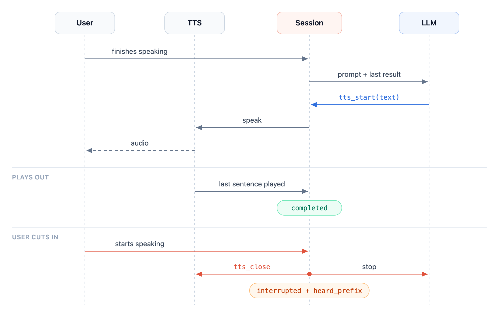

# Speaking Is an Action: Turning TTS into a Tool for Interactive Models

| Model | Fragmented replies in interruption replay | First prompts that call the speech tool | First audio on three-sentence requests |
|---|:---:|:---:|:---:|
| Inkling 2 Mini | TODO → **TODO** | TODO → **TODO** | 1,809 ms → **540 ms** (direct text: 1,163 ms) |
| Inkling 2 Small | TODO → **TODO** | TODO → **TODO** | 2,358 ms → **535 ms** (direct text: 1,602 ms) |
| Qwen3.8-27B | TODO → **TODO** | TODO → **TODO** | 1,171 ms → **622 ms** (direct text: 633 ms) |

## TL;DR

Models keep getting smarter, yet people still talk to them one turn at a time. Human communication is interactive: people keep perceiving while they respond, cut in, and change course when cut off. SGLang Omni builds interactive systems from open models, starting with a cascade of ASR, LLM and TTS coordinated by a Session that continuously runs interaction management. The old cascade read aloud every token the LLM wrote, which left a bad choice: with thinking off the model is dumb, and with thinking on it is far too verbose to say out loud. We wanted the cascade to use tools, and after thinking it through, the best form was to make TTS itself the first one: to the LLM, speaking is a tool call no different from a Google search or a weather lookup. Now the LLM passes `tts_start` only the words worth saying. The Session decides when speech stops and tells the model, through `heard_prefix`, how much the user heard. Across Inkling 2 Mini, Inkling 2 Small and Qwen3.8-27B, streaming the tool argument and prefilling the call opening cut median first audio from TODO ms to TODO ms on average, against TODO ms for the old direct-text path.

## Why Interactive Models

Models keep getting smarter, but the way people work with them has barely changed: write a prompt, wait for a reply. People don't communicate that way. They share the same moment and setting and respond while they perceive: they answer before the other side has finished, rephrase when they see a frown, and change course the moment something changes. In conversation, gaps between turns are around 200 ms, shorter than the 600 ms it takes to plan a sentence (Levinson & Torreira, 2015), and about 40% of turn changes overlap (Heldner & Edlund, 2010). Turn-based systems flatten this into a walkie-talkie exchange and make the human adapt to the machine: say it in one breath, don't pause, don't interrupt, wait. They guess from silence when your input has ended, so they either cut you off when you pause to think or make every turn wait.

The deeper problem is the model itself. A language model experiences the world in a single thread: while the user talks, it waits; while it generates, the world stands still. It sees a prompt, not a stream. It can't notice that you hesitated or looked away, or that its answer is drifting, and it can't feel ten seconds pass. One view holds that a person is a thinking machine taking in the world every 200 ms. Thinking Machines Lab's interaction model keeps reading audio, video and text and producing its response in 200 ms steps, which is what makes it possible to learn when to respond, when to wait and when to stop.

Nor is interaction a layer that can be added afterwards. Every moment holds a decision: speak, wait, stop, or go look something up. These decisions take as much intelligence as the answer itself; hand them to silence thresholds and hand-written rules, and they will be dumber than the model and fall further behind as models improve. So the goal is not a faster turn-based system. Full duplex, perceiving and responding at once, is only the means; the real goal is a model that interacts, whose interaction grows with its intelligence across every modality it can perceive and produce.

## Our Cascade

Native full-duplex models, such as Thinking Machines Lab's interaction model, OpenAI's GPT-Live and Moshi (Défossez et al., 2024), learn interaction end to end, but they need strong omni base models, and open source has few. Turn-based omni models still respond one turn at a time. A cascade of VAD, ASR, LLM and TTS is built from parts open source has in abundance: each upgrades on its own as better models ship, and each failure can be traced to its part. The cost is lost signal: ASR drops tone of voice and merges speakers. SGLang Omni's [streaming cascade](https://www.sglang.io/blog/omni-interactive-runtime) coordinates the parts with a Session that continuously runs interaction management: it decides when the user has finished or cut in, stops playback, and keeps the history in line with what was actually played. The cascade is a bridge to an interactive model. Until open models can make every interaction decision on their own, our rule is: give the model the decisions it makes well, let the system coordinate the signals the model cannot yet perceive, and hand those back as models improve.

## Why TTS Should Be a Tool

Imagine you are driving an electric car and ask its in-car assistant what the weather is like today. What do you expect to hear, and what do you expect to see? You want to hear one sentence, "72°F today", and glance at the touchscreen for the rest of the week. Behind that sentence, the model has already looked the weather up. What you want to hear is short; what you want to see can be rich. This kind of interaction takes real intelligence: the model knows what to think about, what to show and what to say aloud.

Our cascade did not work this way. ASR, the LLM and TTS were nodes at the same level, and TTS read every token the LLM wrote. The surface problem was tokens TTS can't read: emoji, Markdown asterisks, tables. We filtered those out. The real problem is that open LLMs are trained for coding and talk like it: long, structured, thousands of tokens at a time. Turn thinking off and the model gets dumb: its answers go wrong and it handles tools poorly. Turn thinking on and it gets smart, but nobody wants to hear everything it writes.

Reading every token also hides what the user actually heard. When the user cut in, the old cascade trimmed the reply in the history to the played part, ended it with "…" and added a system note. The model then picks up this broken output in context: even when nothing interrupts it, it no longer gives a complete answer and ends with an ellipsis itself. Given 20-turn histories with every reply cut, the setup from [#3255](https://github.com/sgl-project/sglang-omni/pull/3255), TODO% of final answers ended in an ellipsis.

So TTS can't read everything, and the model has to choose. We also wanted the cascade to call tools: the in-car assistant has to check the weather before it can answer. After thinking it through, we found TTS as a tool to be the best form for both, and TTS became our first tool. We demoted it from a pipeline node to a tool; to the LLM, `tts_start` is no different from a Google search or a weather lookup. The model decides what to say. The system decides when speech must stop and records what the user likely heard. A tool call is the interface between them, and this is our answer, for speaking, to the question the runtime post left open: how much interaction behavior the model should learn, and how much the system should coordinate.

## System Design

The Session, the LLM and the TTS work together under three rules:

- **Only the Session changes state.** The LLM issues actions and the TTS executes them, but only the Session decides whether speech is on. Nodes never message each other, so their views of the state can't drift.
- **Each action has one owner.** `tts_start` belongs to the LLM and `tts_close` to the Session, so nobody races over who stopped what.
- **Each call gets one answer.** One `tts_start` gets one tool response, so `tool_call_id` is the only ID we need.

| Action | Called by | What it does |
|---|---|---|
| `tts_start(text)` | The LLM | Splits the text into sentences, then synthesizes and plays them one by one |
| `tts_close` | The Session, when the user starts talking | Stops playback at once and clears the buffers. It is not in the LLM's tool list. |

A Session plays one speech at a time. A second `tts_start` during playback gets `BUSY` instead of replacing it.

<div align="center">
  
</div>

Every `tts_start` ends in exactly one outcome:

<div align="center">
  
</div>

`heard_prefix` is the part of the text the playback record says the user heard ([how it is computed](#computing-heard_prefix)).

**Interruption takes a fast path.** When voice activity detection (VAD) detects the user speaking, the Session closes the TTS and stops the LLM at once, without asking the LLM. Routing the user's words through ASR and the LLM first would let more audio play, and that audio would be recorded as heard although the user, who was talking, missed it.

## Design Trade-offs

### Thinking On or Off?

This trade-off is where the design starts. Without thinking, the models generalize poorly to a tool like this (unfortunately, we found that with thinking off, models have almost no zero-shot ability to operate tools): offered `tts_start` as an option, TODO of TODO first prompts called it. With thinking, they call it unforced, and because TTS is a tool, the thinking is never spoken. The cost is latency: writing the whole text took a median of TODO s before any audio. The profiles in this post therefore run with thinking off and force the call ([next section](#making-real-models-use-it)). Making thinking cheap enough to keep on is still open.

| Measure | Inkling 2 Mini | Inkling 2 Small | Qwen3.8-27B |
|---|---:|---:|---:|
| Thinking off: optional `tts_start` called | TODO/TODO | TODO/TODO | TODO/TODO |
| Thinking on: optional `tts_start` called | TODO/TODO | TODO/TODO | TODO/TODO |
| Thinking on: median time to first audio | 1.5 s | 2.0 s | 3.4 s |

### When Does a Call Get Its Answer?

A speech lasts seconds, and the model needs to know how it ended. Answering `tts_start` at once with "accepted" and reporting completion later gives every call two answers, and tying them together needs a second ID that every later operation must carry.

We answer only when the model needs to act on the answer: a refused call at once, an accepted call once, when the speech ends. One call, one result, no second ID. The model learns nothing while it speaks, which costs little because nothing prompts it during that time anyway.

### Who May Stop a Speech?

We considered an LLM-side close, a `tts_edit` that rewrites sentences in flight, letting a new `tts_start` replace the current one, and queueing concurrent starts. We chose the narrowest option: only VAD triggers a close, through the Session, and a second start gets `BUSY`.

The LLM doesn't know how far its speech has got and was never trained on an interface like this, so it can't be trusted to stop at the right moment. An edit needs sentence splitting, lock points, version numbers and a way to drop stale audio. A close already returns the stop position, so close-then-restart covers the same need with far less machinery. The cost: the model can't correct itself mid-speech.

### How Does the Model Learn What Was Heard?

The Session writes the stop position into the tool result and updates it as playback reports arrive, using sentence boundaries by default and word timings when an aligner is on. The next prompt carries the new input and that result. An interrupted speech can enter the history in three ways:

| Approach | What the model sees |
|---|---|
| Trim the reply to what was heard (old cascade) | An assistant reply ending in an ellipsis, plus a system note |
| Put an interruption note in the user message | The heard text, inside the user's account of the interruption |
| Keep the call, put `heard_prefix` in the tool response (ours) | The generated text in the call, the heard text in its result |

Ours keeps what the model wrote apart from what was played; the call holds everything the model had written when it was cut. In one replay with Qwen3.8-27B, the call said "The parcel code is V2P2." and `heard_prefix` ended at "The pickup desk is next to the main entrance." Asked whether it had read the code aloud, the model's next `tts_start` said "Not yet read. The code is V2P2." TODO: the same replay with Inkling 2 Mini and Inkling 2 Small.

## Making Real Models Use It

**Forcing the call.** With `tool_choice: required`, TODO of TODO first prompts called `tts_start`. If a server ignores `tool_choice` and the model writes plain text, that text is spoken as if it were a `tts_start` call and reported the same way.

**Ending a turn.** If every prompt requires a call, the model can't choose silence. We tried a `silent` tool: on a Session's first input the models chose silence for TODO of TODO plain questions, and after a completed speech they repeated their answer in TODO of TODO samples (TODO of TODO with a `silent` action instead). So the system ends the turn after one successful speech per user input and puts the result in the next prompt. The model is prompted again only if its call was refused or the speech failed, at most four times per input.

**First-audio latency.** SGLang's stock tool-call parser (`qwen3_coder` for Qwen3.8-27B, `inkling2` for Inkling 2 Mini and Inkling 2 Small) releases the text argument only at its closing tag, so synthesis waits for the whole argument. Two changes fix that:

1. Our chat service streams the `text` argument as the model writes it, so the first sentence is synthesized while the rest is still being written.
2. We [prefill the call opening](https://github.com/sgl-project/sglang-omni/pull/4472) as an assistant message for the model to continue (`continue_final_message: true`, `tool_choice: auto`), so decoding starts at the spoken text. For Qwen3.8-27B the opening is the 14 tokens `<tool_call>\n<function=tts_start>\n<parameter=text>\n`; for Inkling 2 Mini and Inkling 2 Small it is the 42 tokens `<|message_model|><|content_thinking|>The user asked something; I answer it rather than repeat it.<|end_message|><|message_model|>tts_start<|content_invoke_tool_json|>{"name":"tts_start","args":{"text":"`, which also writes the thinking block, so no thinking is generated on this path.

| Configuration (one / three sentences requested) | Inkling 2 Mini | Inkling 2 Small | Qwen3.8-27B |
|---|---:|---:|---:|
| TTS reads the model's text (old pipeline) | 937 / 1,163 ms | 1,272 / 1,602 ms | 762 / 633 ms |
| `tts_start`, SGLang's parser | 1,162 / 1,809 ms | 1,704 / 2,358 ms | 1,134 / 1,171 ms |
| `tts_start`, streamed argument | 1,209 / 1,812 ms | 1,696 / 2,117 ms | 1,116 / 829 ms |
| `tts_start`, streamed argument and prefilled opening | 544 / 540 ms | 608 / 535 ms | 918 / 622 ms |

The table above uses each model's shipped profile: Qwen3.8-27B with thinking off, the Inkling models at `reasoning_effort: 0.1`. Only the prefilled row compares like with like, since no model generates thinking there. With thinking on for every model and no prefilled opening (it leaves no room to think):

| Thinking on (one / three sentences requested) | Inkling 2 Mini | Inkling 2 Small | Qwen3.8-27B |
|---|---:|---:|---:|
| Low, TTS reads the model's text | 890 / 1,263 ms | 1,265 / 1,579 ms | 2,192 / 2,637 ms |
| Low, `tts_start`, streamed argument | 1,168 / 1,872 ms | 1,870 / 2,252 ms | 3,097 / 2,715 ms |
| Medium, TTS reads the model's text | 914 / 1,313 ms | 1,464 / 1,718 ms | TODO / TODO ms |
| Medium, `tts_start`, streamed argument | 1,494 / 1,998 ms | 2,021 / 2,648 ms | 3,441 / 3,175 ms |

Low and medium are `reasoning_effort` 0.2 and 0.7 for Inkling and `low` and `medium` for Qwen3.8-27B.

We replayed the same 15 clips per configuration and reply length; every turn produced audio (15 of 15 in each configuration and reply length). The table shows medians from the client sending the packet with the VAD-detected speech end to receiving the first nonempty audio chunk. On three-sentence requests, streaming saved TODO ms and prefill another TODO ms (paired medians), and the final tool path is TODO ms slower than direct text (TODO ms on one-sentence requests).

**Failure.** Failed speech isn't retried; it returns `failed`. The profile's TTS timeout is 10 s instead of 120 s. If synthesis fails after some sentences have played, the response carries `heard_prefix` and a note telling the model to say only the rest. Without the note, the models restarted from the beginning in TODO of TODO samples; with it, TODO of TODO.

| Behavior | Inkling 2 Mini | Inkling 2 Small | Qwen3.8-27B |
|---|---:|---:|---:|
| First prompts calling `tts_start` under `tool_choice: required` | TODO/TODO | TODO/TODO | TODO/TODO |
| Plain questions answered with silence on a Session's first input | TODO/TODO | TODO/TODO | TODO/TODO |
| Answer repeated after a completed speech (`silent` tool) | TODO/TODO | TODO/TODO | TODO/TODO |
| Answer repeated after a completed speech (`silent` action) | TODO/TODO | TODO/TODO | TODO/TODO |
| Restarted from the beginning after a failure (no note) | TODO/TODO | TODO/TODO | TODO/TODO |
| Restarted from the beginning after a failure (with note) | TODO/TODO | TODO/TODO | TODO/TODO |

## Evaluation

We ran [four evaluations](https://github.com/zhaochenyang20/Awesome-ML-SYS-Tutorial/pull/311#issuecomment-7124364587) with Inkling 2 Mini, Inkling 2 Small and Qwen3.8-27B on [SGLang Omni at `02e5103`](https://github.com/sgl-project/sglang-omni/tree/02e5103ce0428b8a37e2339116b96a516c0eb36f), Qwen3.8-27B on one H200, Inkling 2 Mini on one H200 and Inkling 2 Small on four H200s (`--tp 4`). The Inkling runs use [SGLang Omni at `21a6d22`](https://github.com/sgl-project/sglang-omni/tree/21a6d229c), which adds Inkling's streamed arguments and prefilled opening ([#4495](https://github.com/sgl-project/sglang-omni/pull/4495)); Inkling 2 Small runs behind the same chat service inside its own serving image. The text gives the mean over the three models and the tables give each model. Latency is covered above.

**Full-Duplex-Bench.** We ran the direct-text and prefilled tool paths at four concurrent sessions on 100 v1.5 pairs (25 per category) and 30 v1.0 samples (10 per public subset). The local Qwen judge labeled TODO/25 direct-text backchannel cases as resuming the original speech, against TODO/25 for the tool path. Cases labeled as responding went from TODO/25 to TODO/25, and v1.5 mean response latency from TODO s to TODO s. These are single runs, and the licensed CANDOR subsets are left for later.

| Direct text → tool path | Inkling 2 Mini | Inkling 2 Small | Qwen3.8-27B |
|---|---:|---:|---:|
| Backchannels judged as resuming the original speech (/25) | 23 → 10 | 24 → 21 | 24 → 15 |
| Cases judged as responding (/25) | 0 → 11 | 1 → 2 | 0 → 3 |
| v1.5 mean response latency | 1.44 s → 0.76 s | 1.33 s → 0.76 s | 0.86 s → 0.90 s |

That table uses the shipped profiles (Qwen3.8-27B with thinking off, Inkling at 0.1; the tool path has the prefilled opening). With thinking on for every model, and so no prefilled opening:

| Direct text → tool path, thinking on | Inkling 2 Mini | Inkling 2 Small | Qwen3.8-27B |
|---|---:|---:|---:|
| Low: backchannels resuming (/25) | 24 → 14 | 24 → 15 | 18 → 13 |
| Low: cases responding (/25) | 0 → 7 | 0 → 2 | 0 → 1 |
| Low: v1.5 mean response latency | 1.54 s → 1.57 s | 1.33 s → 1.39 s | 2.00 s → 2.09 s |
| Medium: backchannels resuming (/25) | 20 → 14 | 23 → 18 | 12 → 14 |
| Medium: cases responding (/25) | 0 → 2 | 0 → 2 | 0 → 1 |
| Medium: v1.5 mean response latency | 1.90 s → 2.16 s | 1.71 s → 1.61 s | 2.20 s → 2.19 s |

**Fragments after repeated interruptions.** We rebuilt four 20-turn conversations from the topics in [#3255](https://github.com/sgl-project/sglang-omni/pull/3255#experiments), marked the first 30% of each prior reply as heard, and sampled 32 final answers per conversation and history format. Trimmed replies with a system note: TODO/128 answers ended in an ellipsis (TODO%). An English inline note: TODO/128. `tts_start` with `heard_prefix`: TODO/128.

| History format (answers ending in an ellipsis, /128) | Inkling 2 Mini | Inkling 2 Small | Qwen3.8-27B |
|---|---:|---:|---:|
| Trimmed reply with a system note | TODO | TODO | TODO |
| English inline note | TODO | TODO | TODO |
| `tts_start` with `heard_prefix` | TODO | TODO | TODO |

**History replay.** In both conditions the tool argument held a random code; the heard condition also had it in `heard_prefix`. Asked whether they had read the code, the models answered correctly in both conditions for TODO of 32 pairs and put the right code in their next `tts_start` in TODO of 64 cases. These are direct chat requests with a supplied playback history: they test how the model uses the record, not live playback alignment.

| Measure | Inkling 2 Mini | Inkling 2 Small | Qwen3.8-27B |
|---|---:|---:|---:|
| Correct in both conditions (/32 pairs) | TODO | TODO | TODO |
| Right code in the next `tts_start` (/64) | TODO | TODO | TODO |

## Limitations and Open Questions

Most of what's open is about where control should sit.

**Thinking and tool calls.** We want thinking on, but users won't wait for it, and tool calls take time too. One idea is a short acknowledgment while the model thinks or calls a tool, such as "OK, let me check the weather" within half a second. The hard part is that this line and the speech after the tool returns are two separate syntheses, and they have to sound like one continuous utterance.

**Screen.** Someone driving an electric car should hear "72°F" and see the week on the touchscreen. We don't yet have a good answer for rendering: how should the model decide what to render? TTS as a tool has made what gets spoken fairly smart, and it lets what is shown differ from what is spoken; but the demo still shows exactly what it says, and what to render still needs design.

**More tools.** TTS is the only tool so far; Google search and weather lookups are next. Asynchronous tools conflict with "one speech per user input": "let me check, then tell you" needs a second speech. When a result arrives after the speech has ended, who triggers it: a system rule, or a fresh prompt to the model?

**Self-correction.** When should `tts_close` or an edit go back to the model? Only once the model can tell how far its speech has got.

**Steering.** When the user talks while the model is mid tool loop, should the system interrupt at once, or finish the loop and then add the user's words?

**Multiple speakers.** The ASR has no context and doesn't tell speakers apart, so several people's words merge into one. How far to support multiple speakers is still an open question.

**Interruption and speech rejection.** Interruption takes the fast path: the moment VAD detects voice, the Session closes the TTS. The VAD only reports whether someone is speaking, understands nothing of what is said, and its signal never reaches the LLM, so the model cannot judge whether it should stop. Its threshold is also low: background music, someone talking across the room or several people chatting all cut the speech off, while in the same noisy room the ASR often picks out the user's voice and leaves the music out. The system needs speech rejection: when the user says something unrelated to the conversation, or someone else talks, it should know not to stop. That is a semantic judgment, and it may cost some interruption latency. Directions include semantic probes on the VAD, a rejection model that accepts only the target speaker's voice, and a user setting for the VAD threshold.

The Session stops speech today because it sees continuous input and the playback timeline. If future models can use those signals directly, `tts_close` could become a model tool.

## Engineering Appendix

### Streaming Tool-Call Parsers

SGLang 0.5.23's `qwen3_coder` parser, used for Qwen3.8-27B, releases a string parameter only at its closing tag, so a reply's text arrived all at once, TODO s in. `sglang_omni.models.streaming_cascade.chat_service` is `sglang.launch_server` with a parser that subclasses SGLang's detector and releases string arguments as they are written; with it, the first sentence was complete at TODO s. Because the chat service depends on SGLang internals, a test checks that it produces the same calls as SGLang's detector.

Inkling 2 Mini and Inkling 2 Small use SGLang's `inkling2` parser; TODO ( when a reply's text arrived with it, and when the first sentence was complete with streaming).

### Continuing the Call Opening

When a prompt requires a call, the `llm` node sends the call opening as an assistant message with `continue_final_message: true` and `tool_choice: auto`. The chat service puts the opening in front of the first streamed delta, so the reply still arrives as a streamed `tts_start` call. SGLang's own server would return the rest of the call as content, closing tags included, and the dialog would speak them, so this option needs the chat service. With the opening, the first sentence matched the unprefilled reply in TODO of TODO pairs for Inkling 2 Mini, TODO of TODO for Inkling 2 Small and TODO of TODO for Qwen3.8-27B.

### Computing `heard_prefix`

- The prefix ends at the last sentence boundary whose audio has finished playing.
- The playback position is the client's `truncate` report, capped at the audio the server actually sent.
- With the forced aligner, the position is word-accurate. A sentence cut before its audio was complete has no word timings, so the cascade's own recognizer transcribes the delivered audio and keeps the longest prefix of that sentence the transcript confirms.
- Later reports rewrite `heard_prefix`, so the next prompt holds the latest position.
- When a speech fails, the position comes from the synthesizer's `turn.done`, not `reply.progress`: with the aligner on, `reply.progress` reaches the dialog after `turn.done`, and its word positions can arrive after the sentence end.

This reuses the playback feedback path from the runtime post's appendix ("Committing Conversation History from Playback"). Only its destination, the tool response, is new.

## Usage and Acknowledgments

### Usage

The Inkling 2 Mini profile is `qwen3-asr-inkling-2-mini-vivian-tts-tool`; its chat service runs in its own environment, installed with `examples/streaming_cascade/inkling_chat_service.sh install`. Inkling 2 Small has no profile yet (TODO); we ran it with the Mini profile pointed at a chat service started inside the Inkling 2 Small serving image. The Qwen3.8-27B profile is `qwen3-asr-qwen3.8-27b-vivian-tts-tool`; it needs two GPUs, or one H200 using the memory fractions given in the guide.

```bash
hf download Qwen/Qwen3-ASR-1.7B
hf download wilsonzheng0327/Qwen3-ASR-1.7B-dflash --revision d62bd4051e68282e02f93de774036a35f22f1373
hf download thinkingmachines/Inkling-2-Mini --revision b85c3cfa615fc413cc9af3379f491b963f3b586a  # Inkling 2 Mini
hf download thinkingmachines/Inkling-2-Small  # Inkling 2 Small
hf download Qwen/Qwen3.8-27B
hf download Qwen/Qwen3-TTS-12Hz-1.7B-Base
hf download Qwen/Qwen3-ForcedAligner-0.6B
```

```bash
PYTHONPATH=. aligner-venv/bin/python examples/streaming_cascade/alignment_worker.py --model Qwen/Qwen3-ForcedAligner-0.6B --device cuda:1 --language English --port 8010
```

```bash
# Inkling 2 Mini
sgl-omni serve --config examples/streaming_cascade/profiles/qwen3-asr-inkling-2-mini-vivian-tts-tool/launch.yaml --enable-realtime --port 8765
# Inkling 2 Small
sgl-omni serve --config examples/streaming_cascade/profiles/TODO/launch.yaml --enable-realtime --port 8765
# Qwen3.8-27B
sgl-omni serve --config examples/streaming_cascade/profiles/qwen3-asr-qwen3.8-27b-vivian-tts-tool/launch.yaml --enable-realtime --port 8765
```

The "A live demo of the reference profile" section of the [Full-Duplex Guide](https://github.com/sgl-project/sglang-omni/blob/main/docs/developer_reference/full_duplex_guide.md), added in [#4473](https://github.com/sgl-project/sglang-omni/pull/4473), covers the aligner environment, the one-H200 layout and the browser demo. The "Speaking Through a Tool" section of the same guide describes the profile in full.

### Acknowledgments

The `tts_start` path landed in [sgl-project/sglang-omni#4428](https://github.com/sgl-project/sglang-omni/pull/4428). We thank everyone who contributed to it: Jingwen Gu, Yuhao Chen, Jiaxin Deng, Wenyao Gao, Jiadong Guo, Jeffero Qu, Junnan Li, Qun Lou, Jiaxian Luo, Jinyan Su, Xuesong Ye, Wilson Zheng, Chenyang Zhao.
