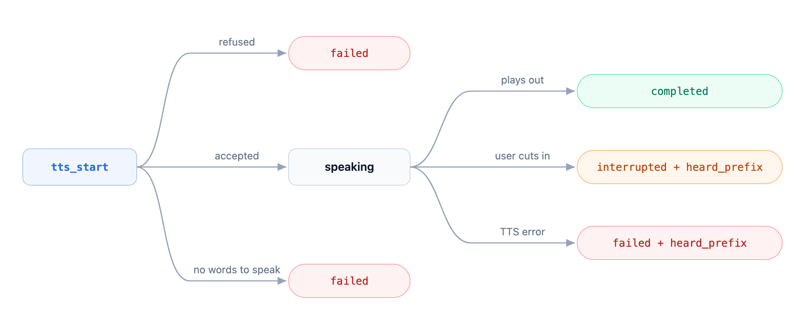

# TTS as a Tool: The LLM Decides What to Say, the System Decides When to Stop

| Fragmented replies in interruption replay | First prompts that call the speech tool | First audio on three-sentence requests |
|:---:|:---:|:---:|
| 12/128 → **0/128** | 12/24 → **36/36** | 1,198 ms → **705 ms** (direct text: 655 ms) |

## TL;DR

In SGLang Omni's streaming cascade, the model calls `tts_start` with the text it wants spoken. The Session monitors incoming speech, decides when playback stops, and records how far it got. The tool result reports whether speech completed, was interrupted, or failed, and can include an estimated `heard_prefix`. This gives the model a record of what the listener likely heard. It can also choose wording specifically for speech, with brevity still depending on the model and prompt. Scheduling speech alongside asynchronous tools remains open.

We required a speech call and ended the turn after one successful speech to make Qwen3.8-27B use the tool reliably. Streaming the text argument and prefilling the call opening reduced the median time to first audio from 1,198 ms to 705 ms on matched three-sentence requests. On the same H200, the old direct-text path took 655 ms.

## 1. Introduction

Ask a human assistant to book you a flight and three things happen that nobody thinks about. They tell you the two options that matter rather than every fare on the screen. If you cut in halfway through the second option, they know you only heard the first. And they say "let me check" while they're already looking it up.

A full-duplex system has to do all of this while the conversation keeps moving. The language model in this cascade receives discrete prompts and generates replies. The Session observes input continuously and tracks playback timing, including how far a reply got before the listener cut in. Our [post on SGLang Omni's interactive runtime](https://www.sglang.io/blog/omni-interactive-runtime) ended on an open question about how much interaction behavior a model should learn and how much the surrounding system should coordinate. Native full-duplex models learn timing inside the model. Cascaded systems hand it to an external controller, and in return each component can be upgraded on its own. This post answers that question for speaking in a cascade.

Our answer is a split of control. The model decides what to say. The system decides when speech must stop and keeps a record of the estimated playback position. A tool call is the interface between the two.

## 2. The Problem: TTS as a Fixed Stage of the Pipeline

Until this change, the streaming cascade ran ASR → LLM → TTS, with the synthesizer reading every token the model wrote. That had three consequences.

**The model says too much.** An answer written for a screen can be long, structured, and thorough. When the cascade reads the model's text directly, the same wording goes to speech. The `text` argument of `tts_start` gives the model a place to choose what should be spoken. The profile prompts for short spoken replies, and how much the tool reduces over-speaking remains to be measured.

**The model doesn't know what the user heard.** When the user cuts in, the old cascade trims the reply in the history down to the part that was played, ends it with "…" and adds a system note. The model can imitate those shortened replies. In [#3255](https://github.com/sgl-project/sglang-omni/pull/3255), 25% of final answers ended in an ellipsis when Qwen3.8-27B was given 20-turn histories with every reply cut. The tool result makes playback progress explicit in the history through `heard_prefix`.

**Speaking while other tools run.** An assistant should be able to say "let me check" while a lookup runs. A speech tool gives the Session a separate action it could schedule. The current profile ends the turn after one successful speech per user input. Scheduling asynchronous tools and speaking again when their results arrive remain open design questions (Section 7).

The first implementation focuses on what gets recorded after speaking. The `tool_call_id` identifies the action, and the call and its result together record the model's wording and the outcome in the conversation history.

## 3. Design

The design rests on three constraints, each of which rules out a specific failure:

- **The Session is the only thing that changes state.** The LLM issues actions and the TTS carries them out, but only the Session decides whether speech is on. Nodes don't message each other directly, so their views of the state can't drift apart.
- **Each action has one owner.** `tts_start` belongs to the LLM and `tts_close` to the Session. Two parties never operate the TTS at once, so they can't race over who stopped what.
- **Each call gets one answer.** One `tts_start` gets one tool response. A call answered twice would need a second ID to tie the answers together. With one answer, the `tool_call_id` is all we need.

On top of these there is one division of labor. The model owns what is said, and the system owns stopping speech and recording what the user heard.

| Action | Called by | What it does |
|---|---|---|
| `tts_start(text)` | The LLM | Splits the text into sentences, then synthesizes and plays them one by one |
| `tts_close` | The Session, when the user starts talking | Stops playback at once and clears the buffers. It is not in the LLM's tool list. |

A Session plays one speech at a time. A second `tts_start` while one is playing gets `BUSY` rather than silently replacing it. The normal path and the interruption path look like this:

<div align="center">
  
</div>

Every `tts_start` ends in exactly one outcome:

<div align="center">
  
</div>

`heard_prefix` is the part of the text that the playback record indicates the user heard. Section 8.3 explains how it is computed.

**Interruption takes a fast path.** When voice activity detection hears the user, the Session closes the TTS and stops the LLM at once, without asking the LLM. Waiting for the user's words to go through ASR and the LLM first would leave time for more audio to play. Everything played in that window would be recorded as said, although the user, who was talking, never heard it.

## 4. Design Trade-offs

Each trade-off below follows the same pattern: the question, the options, what we chose, why, and what it costs.

### 4.1 When Does a Call Get Its Answer?

A speech lasts seconds, and the model needs to know how it ended. The obvious design answers `tts_start` immediately with "accepted" and reports completion later as a separate event. But then every call has two answers, and something has to tie them together, which means a second ID next to the `tool_call_id`, and every later operation has to carry it.

We answer only when the model needs to act on the answer. A refused call is answered at once. An accepted call is answered once, when the speech ends. This keeps the ordinary meaning of a tool call, one call and one result, and the second ID disappears along with everything that would have depended on it. The cost is that the model learns nothing while it is speaking. That costs little, because nothing prompts the model while it speaks anyway.

### 4.2 Who May Stop a Speech?

We considered letting the LLM close its own speech, a `tts_edit` that replaces sentences in flight, letting a new `tts_start` replace the speech in progress, and queueing concurrent starts. We chose something narrower. Only voice activity detection triggers a close, and it goes through the Session. The first version has no LLM close and no edit, and a second start gets `BUSY`.

The reason goes back to the thesis. The LLM doesn't know how far its speech has got, and it hasn't been trained on an interface like this, so we can't expect it to stop at the right moment. An edit needs sentence splitting, lock points, version numbers and a way to discard audio that is already out of date. A close already returns the stop position, so closing and starting again covers the same need with far less machinery. The cost is real: the model can't correct itself in the middle of a speech.

### 4.3 After an Interruption

**How the model learns what was heard.** We could stream playback progress back to the model, or give it a list of sentences to query. In this design, the Session records the stop position in the tool result and can update it as playback reports arrive. Its estimate uses sentence boundaries by default and can use word timings with an aligner. The next prompt includes the new input and the interrupted call's result.

**How an interrupted speech appears in the history.** There were three candidates:

| Approach | What the model sees |
|---|---|
| Trim the reply to what was heard (the old cascade) | An assistant reply ending in an ellipsis and a system note about interrupted speech |
| Put an interruption note in the user message | The heard text appears in the user's account of the interruption |
| Keep the call and put `heard_prefix` in the tool response (ours) | The generated text stays in the call and the heard text goes in its result |

The third approach records the model's wording separately from playback. If the user interrupts while the model is still writing, the call keeps the text generated up to that point. If generation has finished, the call keeps the entire argument.

In one history replay (Section 6), the original call included "The parcel code is V2P2." The simulated interruption set `heard_prefix` to end after "The pickup desk is next to the main entrance." When asked whether it had already read the code aloud, the model's next `tts_start` said "Not yet read. The code is V2P2."

## 5. Making a Real Model Use It

The design was the easy part. Getting Qwen3.8-27B to use it well took a series of experiments.

**Forcing the call.** With `tts_start` offered as an option, only 12 of 24 first prompts called it, and the rest answered in plain text. With `tool_choice: required`, 36 of 36 did. With thinking on, the model calls the tool without being forced, but writing the whole text then took a median of 3.1 s, so the profile runs with thinking off. As a fallback, if a server ignores `tool_choice` and the model writes plain text, that text is spoken as if it were a `tts_start` call, and its result is reported, cut short or followed up in the same way.

**Ending a turn.** If every prompt requires a call, the model can't choose silence. So how does a turn end? We tried giving it a way out, a `silent` tool. On a Session's first input it chose silence for 34 of 50 plain questions. After a completed speech it repeated its answer in 10 of 49 samples with a `silent` tool, and in 22 of 50 with a `silent` action. The system now **ends the turn after one successful speech per user input** and includes the result in the model's next prompt. It is prompted again only if its call was refused or the speech failed, at most four times per input. This limits a common use of asynchronous tools, where the assistant says "let me check" and speaks again when a result arrives.

**First-audio latency.** The stock SGLang `qwen3_coder` parser releases the text parameter at its closing tag, so the synthesizer waits for the whole argument. Two changes let synthesis start sooner.

1. Our chat service streams the `text` argument as the model writes it, so the first sentence is synthesized while the model writes the rest.
2. We [prefill the 14-token call opening](https://github.com/sgl-project/sglang-omni/pull/4472), `<tool_call>\n<function=tts_start>\n<parameter=text>\n`, as an assistant message the model continues (`continue_final_message: true`). Decoding starts at the spoken text. These requests use `tool_choice: auto` because the supplied opening already starts the call.

| Configuration | Requested one sentence | Requested three sentences |
|---|---:|---:|
| TTS reads the model's text (old pipeline) | 776 ms | 655 ms |
| `tts_start`, SGLang's parser | 1,109 ms | 1,198 ms |
| `tts_start`, streamed argument | 1,150 ms | 876 ms |
| `tts_start`, streamed argument and prefilled opening | 947 ms | 705 ms |

We replayed the same 15 clips for each requested reply length in each configuration on one H200. All 120 measured turns completed with audio. The table shows medians from when the client sent the packet containing the VAD-detected speech end to when it received the first nonempty audio chunk.

For three-sentence requests, streaming saved a median of 305 ms across the 15 pairs and prefill saved another 205 ms relative to streaming alone. For one-sentence requests, streaming alone added a median of 5 ms across pairs. The final tool path took a paired median of 43 ms longer than direct text on three-sentence requests and 172 ms longer on one-sentence requests.

**Failure.** Failed speech isn't retried. It fails loudly and returns `failed`. In this profile the TTS timeout is 10 s instead of 120 s. When synthesis fails after some sentences have played, the response carries `heard_prefix` along with a note telling the model to say only the rest. Without the note, the model restarted from the beginning in 13 of 20 samples. With it, that dropped to 0 of 20.

## 6. Evaluation

We ran the [four evaluations](https://github.com/zhaochenyang20/Awesome-ML-SYS-Tutorial/pull/311#issuecomment-7124364587) on one H200 with Qwen3.8-27B and [SGLang Omni at `02e5103`](https://github.com/sgl-project/sglang-omni/tree/02e5103ce0428b8a37e2339116b96a516c0eb36f). Section 5 reports the latency results. The other runs measure conversation behavior and what the model learns from interruption history.

**Full-Duplex-Bench.** We ran the direct-text and prefilled tool paths at four concurrent sessions, using the same 100 v1.5 pairs (25 per category) and 30 v1.0 samples (10 per public subset). The local Qwen judge labeled 21/25 direct-text backchannel cases as resuming the original speech, compared with 14/25 for the tool path. Cases labeled as responding rose from 0/25 to 6/25. The v1.5 mean response latency went from 0.950 s to 1.076 s. These are single-run observations. The v1.0 numbers cover the public subsets, with the licensed CANDOR subsets left for future runs. The optional A/F/U judge ran during the preflight.

**Fragment rate after repeated interruptions.** We rebuilt four 20-turn conversations from the topics in [#3255](https://github.com/sgl-project/sglang-omni/pull/3255#experiments), marked the first 30% of each prior reply as heard, and sampled 32 final answers per conversation and history format. The shortened assistant replies with a system note produced 12/128 answers ending in an ellipsis (9.4%). The English inline note and `tts_start` with `heard_prefix` each produced 0/128.

**History replay.** The full tool argument contained a randomly chosen code in both conditions. The heard condition also included it in `heard_prefix`. When asked whether it had read the code, the model answered correctly in both conditions for all 32 pairs and included the right code in its next `tts_start` in all 64 cases. These were direct chat requests with a supplied playback history. They measure how the model uses the record, and testing live playback alignment requires a separate experiment.

## 7. Limitations and Open Questions

What's left open is mostly a question of where control should sit.

**Asynchronous tools.** "One speech per user input" conflicts with "let me check, then tell you". When a weather result arrives after the speech has ended, who triggers the next speech: a system rule, or a fresh prompt to the model?

**Self-correction.** When should `tts_close` or an edit go back to the model? That only makes sense once the model can tell how far its speech has got.

**Steering.** When the user talks while the model is in the middle of a tool loop, should the system interrupt immediately, or let the loop finish and then add the user's words?

Today the Session stops speech and records playback progress because it observes continuous input and the playback timeline. If future models can use those signals directly, the system could offer `tts_close` as a model tool.

## 8. Engineering Appendix

### 8.1 A Streaming `qwen3_coder` Parser

SGLang 0.5.23's `qwen3_coder` parser releases a string parameter only at its closing tag. With it, the text of a reply arrived all at once, 1.05 s into the reply. `sglang_omni.models.streaming_cascade.chat_service` is `sglang.launch_server` with a parser that subclasses SGLang's detector and releases a string argument as the model writes it. With that parser, the first sentence was complete at 0.59 s. A test checks that it produces the same calls as SGLang's detector, because the chat service depends on SGLang's internals.

### 8.2 Continuing the Call Opening

When a prompt requires a call, the `llm` node sends the 14-token opening as an assistant message with `continue_final_message: true` and `tool_choice: auto`. The chat service puts the continued opening in front of the first streamed delta, so the reply still arrives as a streamed `tts_start` call. SGLang's own server would return the rest of the call as content, closing tags included, and the dialog would speak them, so this option needs the chat service. With the opening, the first sentence matched the reply without it in 21 of 24 pairs.

### 8.3 Computing `heard_prefix`

- The prefix ends at the last sentence boundary whose audio has finished playing.
- The playback position is the client's `truncate` report, capped at the audio the server actually sent. A client report never moves the position past what was delivered.
- With the forced aligner, the position is accurate to the word. A sentence cut before its audio was complete has no word timings, so the cascade's own recognizer transcribes the delivered audio and keeps the longest prefix of that sentence the transcript confirms.
- Reports of what was heard that arrive later rewrite `heard_prefix`, so the next prompt holds the latest position.
- When a speech fails, the position comes from the synthesizer's `turn.done`, not from `reply.progress`. With the aligner on, `reply.progress` reaches the dialog after that `turn.done`, and its word positions can arrive after the sentence end.

None of this is new machinery. The tool response reuses the playback feedback path described in the runtime post's appendix ("Committing Conversation History from Playback"). The only change is that its result now goes into the tool response.

## 9. Usage and Acknowledgments

### Usage

The profile is `qwen3-asr-qwen3.8-27b-vivian-tts-tool`. It needs two GPUs, or one H200 using the memory fractions given in the guide.

```bash
hf download Qwen/Qwen3-ASR-1.7B
hf download wilsonzheng0327/Qwen3-ASR-1.7B-dflash --revision d62bd4051e68282e02f93de774036a35f22f1373
hf download Qwen/Qwen3.8-27B
hf download Qwen/Qwen3-TTS-12Hz-1.7B-Base
hf download Qwen/Qwen3-ForcedAligner-0.6B
```

```bash
PYTHONPATH=. aligner-venv/bin/python examples/streaming_cascade/alignment_worker.py --model Qwen/Qwen3-ForcedAligner-0.6B --device cuda:1 --language English --port 8010
```

```bash
sgl-omni serve --config examples/streaming_cascade/profiles/qwen3-asr-qwen3.8-27b-vivian-tts-tool/launch.yaml --enable-realtime --port 8765
```

The "A live demo of the reference profile" section of the [Full-Duplex Guide](https://github.com/sgl-project/sglang-omni/blob/main/docs/developer_reference/full_duplex_guide.md), added in [#4473](https://github.com/sgl-project/sglang-omni/pull/4473), covers the aligner environment, the one-H200 layout and the browser demo. The "Speaking Through a Tool" section of the same guide describes the profile in full.

### Acknowledgments

The `tts_start` path landed in [sgl-project/sglang-omni#4428](https://github.com/sgl-project/sglang-omni/pull/4428). We thank everyone who contributed to it: Jingwen Gu, Yuhao Chen, Jiaxin Deng, Wenyao Gao, Jiadong Guo, Jeffero Qu, Junnan Li, Qun Lou, Jiaxian Luo, Jinyan Su, Xuesong Ye, Wilson Zheng, Chenyang Zhao.
