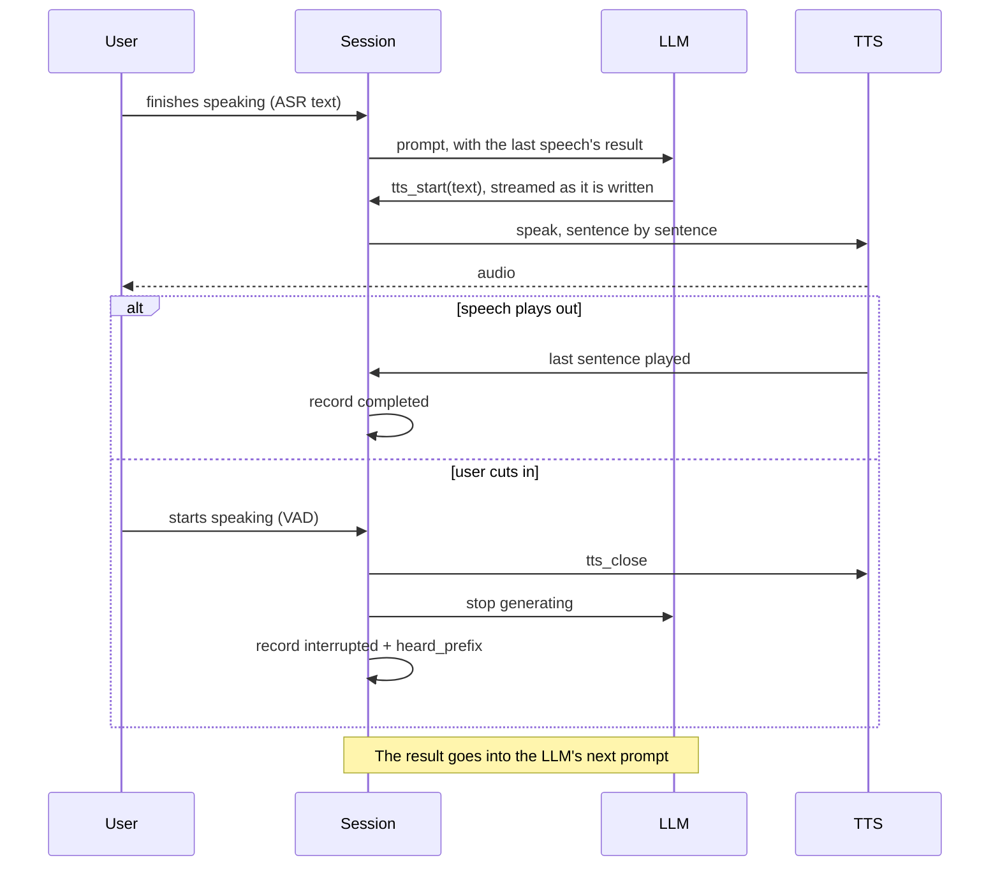

# TTS as a Tool: Letting the LLM Decide When to Speak

A cascaded voice agent chains three models, with ASR turning the user's speech into text, an LLM writing up a reply, and TTS reading that reply aloud. In previous SGLang Omni's streaming cascade, TTS was used as a fixed stage of the pipeline, so every token the LLM wrote went straight to the synthesizer.

While it been the simplest way to give an LLM a voice, the model never actually *decides* when, and what to speak. Every token that the LLM produced, including what it intended for thinking and writing, are all spoken. We hope the model gets to choose what it wants to say, so we changed that. The LLM now speaks by calling a `tts_start` tool, and the tool response for that call tells it how the speech went. 

This post covers why we made the change, what got in the way, and where it stands today.

## Why speaking should be a tool call

Having TTS read everything the LLM writes causes three problems.

**The model says too much.** LLMs are trained to write for a chat window, with long answers full of lists, headings and caveats. When TTS reads everything, all of it gets spoken. In a spoken conversation the reply turns into a monologue.

**The model doesn't know what the user heard.** Users cut in all the time. When they do, in the previous engineering,  the system trims the assistant's text in the history down to what was actually played. The model then sees a history full of chopped-off replies, and through in-context learning it starts imitating them. In one of our tests, every turn was interrupted. A cut-off marker and a system note were in place, and a quarter of the replies still came out as fragments.

**Speech can't run alongside anything else.** An agent should be able to say "let me check" while a weather lookup runs in the background. It should also be able to ask for a slower or warmer voice. Neither works when speech is just whatever comes out of the pipeline.

Agents already have a well-understood way to take actions and get results back: tool calls. So we made speaking one.

## The design

We hope that every action has exactly one owner.

| Action | Called by | What it does |
|---|---|---|
| `tts_start(text)` | The LLM | Splits the text into sentences, then synthesizes and plays them one by one |
| `tts_close` | The Session, when the user starts talking | Stops playback immediately. It is not in the LLM's tool list. |

The Session is the only coordinator, with the LLM issues actions, the TTS carries them out, and only the Session changes state. A Session plays one speech at a time, and the call's `tool_call_id` identifies it.

Each `tts_start` gets exactly one tool response, sent when the speech ends:

| Outcome | Tool response |
|---|---|
| Played to the end | `{"status": "completed"}` |
| User cut in | `{"status": "interrupted", "heard_prefix": "..."}` |
| Synthesis failed | `{"status": "failed", "error": "...", "heard_prefix": "..."}` |

**Interruption takes a fast path.** We hope to treat the interruption as a golden-rule commanded from coordinator. When voice activity detection hears the user, the Session stops the TTS and the LLM right away without consulting the LLM. 

## What got in the way

When we started implementing tts as a tool, we realized most of the work was getting a real model to behave well with the new tool. We used Qwen3.8-27B with thinking off.

**The model wouldn't call the tool.** When `tts_start` was only an option, the model answered in plain text and called the tool in 0 of 50 first prompts. We did a easy solution with multiple ablations, proved to work well: now every prompt now sets `tool_choice: required`.

**Then it couldn't stop talking.** If the model must call a tool every time, how does it end its turn? We tried giving it a `silent` tool. It chose silence for 34 of 50 plain questions. After finishing a speech it often repeated itself: 10 of 49 times with a `silent` tool and 22 of 50 with a `silent` action. The fix was to build the rule into the system instead: **one speech per user utterance**. Once a speech completes, the model isn't prompted again, and the result goes into its next prompt. It is prompted again only when a speech fails or its call is refused.

**Waiting for the whole call was slow.** A tool call's arguments normally arrive only once the call is complete, so the model had to write its whole answer before the first word was spoken. For replies of several sentences, time to first audio nearly doubled. We changed the chat server to stream the `text` argument as the model writes it, so the first sentence is spoken while the model is still writing the rest.

## Where it landed, and what's next

The `tts_start` path is merged into SGLang Omni's main branch in [sgl-project/sglang-omni#4428](https://github.com/sgl-project/sglang-omni/pull/4428), with multiple potential future work coming up.

- **Optimize the latency.** In the latest FDB bench profile, replies of several sentences come within about 0.2 s of the old pipeline. We are trying to close this gap in future development.
- **Other tools alongside speech.** A weather tool comes next. The model says "let me check" while the lookup runs, and the result comes back asynchronously. This is where races between speech, tools and user interruptions get a real test.
- **Speak less, show more.** We want to separate what the model says from what it shows on screen. Details can then go to captions or the UI while the spoken reply stays short.
- **Richer voice control.** `tts_start` should be able to carry speaking rate, emotion and style tags, in line with what the TTS model supports.
- **Interrupted speech in history.** We need to check the "full call plus `heard_prefix`" format against real conversation traces, and make `heard_prefix` accurate to the word everywhere.
- **Hardening.** Instruction-following and Full-Duplex-Bench evaluations need re-running on the new profile. We also want the streaming argument parser upstream in SGLang, so we no longer subclass SGLang's internal parser.

## Acknowledgments

<!-- TBD -->
